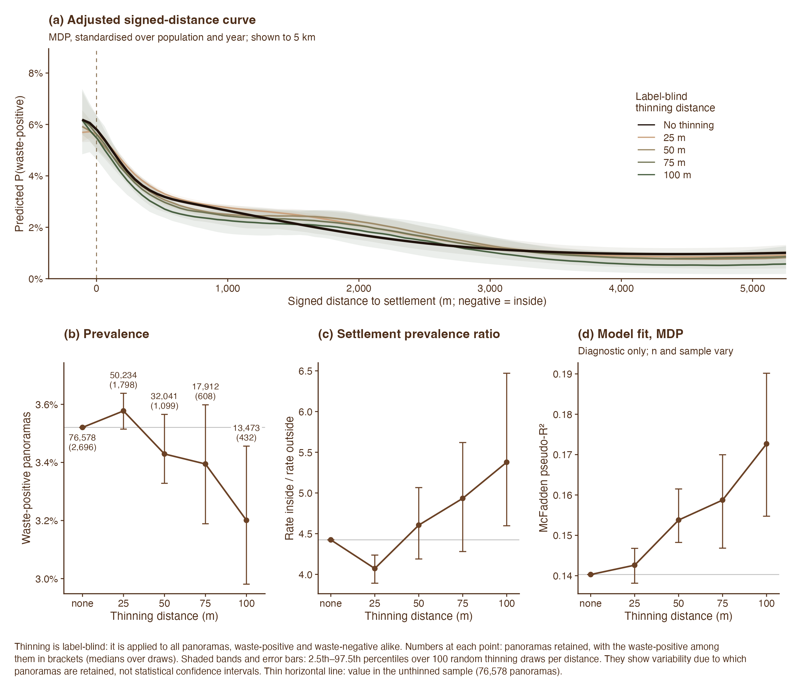
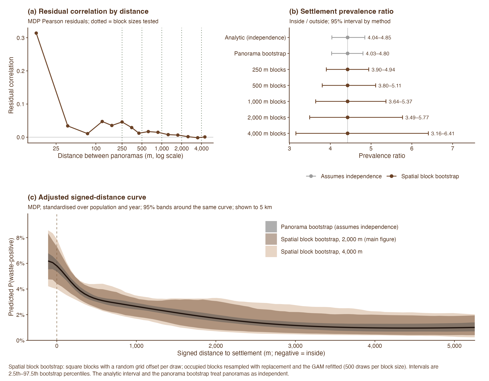
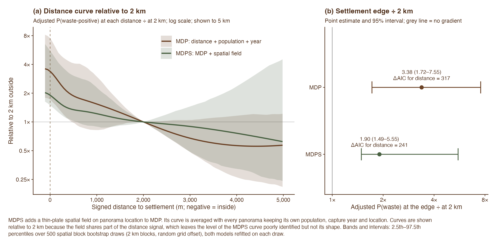
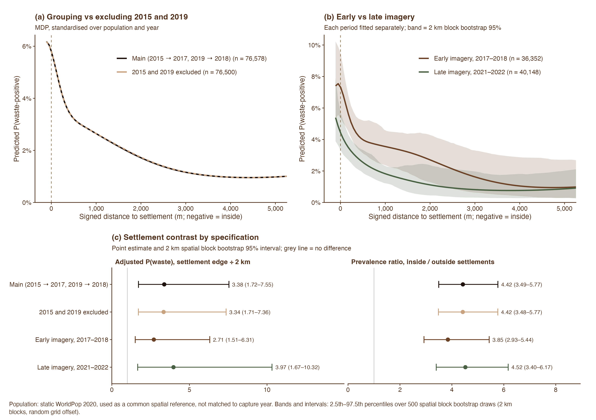
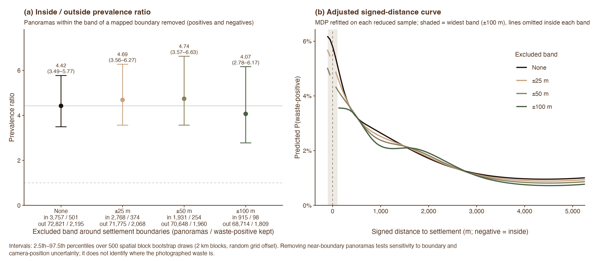
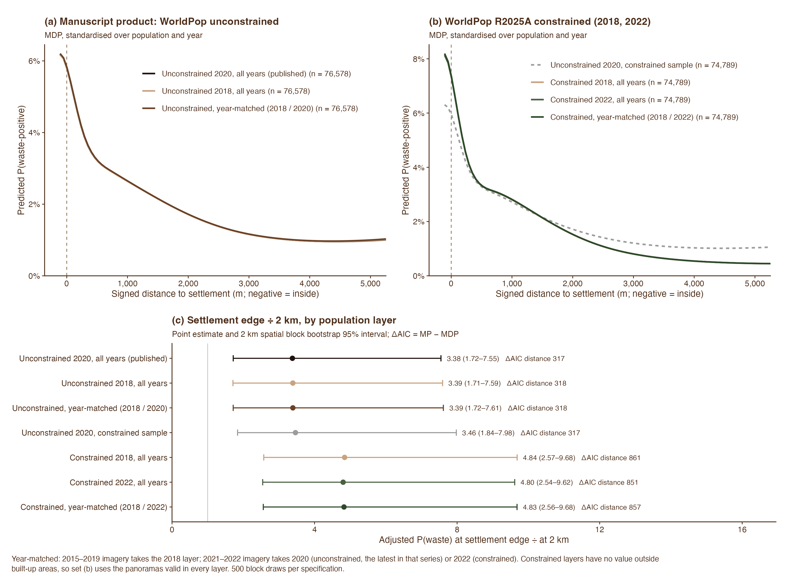

# Chapter_waste — Nairobi waste & SVI spatial analysis

Street-view imagery of Nairobi is turned into a 100 m visible-waste indicator, and the gap between what was *observed* and what the indicator *claims* is measured at every stage.

```
Step 1  prepare      harmonised layers: waste, SVI, boundary, settlements, 100 m grid, roads
Step 0  extend       optional Mollweide fill of grid gaps (preferred grid downstream)
Step 2  coverage     city → road → SVI → waste, on road metres and 100 m cells
Step 3  identify     YOLO and YOLO → Qwen on the independent held-out image set
Step 4  indicator    100 m indicator: observed vs interpolated, validated against local clicks
Step 5  pattern      clustering, settlement association, signed-distance GAM
```

Steps 3–5 each report what the evidence actually supports: Step 3 the classifier's precision, Step 4 the share of the published surface that is estimated rather than measured, Step 5 whether the spatial pattern survives the observation frame.

## Folder structure

```
Chapter_waste/
├── chapter_paths.py            PHD_DATA_ROOT, step dirs, active 100 m grid
├── lib/                        shared Python (arms, paths, ideamaps, provenance, panoids, roads)
├── R/                          shared R (chapter_paths, map_theme, chapter_colours, arms)
├── workflow/                   Snakefile + rules/00–05
│
├── 0_extend_grid/              optional: Mollweide 100 m fill of grid gaps
├── 1prepare_chapter_data/      harmonised layers, local + OSMnx roads, road figures
├── 2coverage_analysis/         1cityroad / 2roadsvi / 3sviwaste / 4roadwaste / 5_gridsvi (+ plots)
├── 3_waste_identification/     held-out metrics, Qwen review, replicate notebook (+ plots)
│                               (data dir also holds training/ — provenance, read by nothing)
├── 4_100m/                     indicator build, crowd validation (+ plots)
├── 5_spatial_pattern/
│   ├── HDBSCAN/                clustering + settlement context
│   ├── settlement/             association, NNR null, temporal robustness
│   └── Signed_distance/        GAM (+ pop_adjusted/ sensitivity)
├── 6_selfcollected/
│   ├── 0_mitigation_summary.py the pipeline-wide anchor table (run last)
│   ├── 1_sources/              what SC imagery is and what coverage it adds
│   ├── 2_identification/       SC in the YOLO training mix (plots only)
│   ├── 3_indicator/            the 100 m surface, rebuilt with SC
│   └── 4_pattern/              HDBSCAN/ settlement/ Signed_distance/, both arms
│
├── Figure/<step>/              outputs, numbered by the block that produces them
```

Data lives outside the repo under `$PHD_DATA_ROOT/Chapter_waste/<step>/`, mirroring these names. Each step writes its chapter tables to `<step>/thesis_table/` and its working outputs beside them.

## Analysis arms

Two arms are defined once in `lib/arms.py`:

| Key | Tag | Sources | Step 1 layers |
| --- | --- | --- | --- |
| `gsvi` | `gsvi` | Google | `Nairobi_{Waste_point,SVI_point,SVI_image}_gsvi_32737.gpkg` |
| `gsvi_selfcollected` | `gsc` | Google + Faith + ZWL | `…_gsvi_selfcollected_32737.gpkg` |

**Steps 2–5 use the GSVI arm throughout.** Step 1 builds both; everything downstream reports GSVI. **Step 6 is where the second arm is used**: it re-runs the relevant parts of Steps 3–5 with self-collected imagery added and reports the difference.

Per-arm files carry the key as infix (`arm.filename("Nairobi_grid_coverage")` → `…_gsvi_32737.gpkg`).

---

## Step 0 — Extend 100 m grid (optional)

Standalone fill of constituency gaps left by Angela’s clipped IDEAMaps grid. Does **not** overwrite Step 1 outputs; writes under `Data/Chapter_waste/0_extend_grid/`.

**Method:** Angela’s `IDEAmaps_grid-boundary-nairobi.gpkg` is an exact 100 m lattice in Mollweide / GHSL (`ESRI:54009`). This step keeps existing clipped Angela cells and `cell_id` values, then fills remaining constituency area with new Mollweide 100 m cells whose centroids fall inside the Nairobi boundary and outside the Angela clip.

| Output | Description |
| --- | --- |
| `Nairobi_grid_100m_extended_32737.gpkg` | Angela + extension cells (`grid_source`, `cell_id`) |
| `Nairobi_grid_100m_extension_cells_32737.gpkg` | Extension cells only |
| `Nairobi_grid_extension_summary.csv` | Cell counts + uncovered % before/after |

Example (current run): Angela 57,013 → +12,930 extension → **69,943** total; uncovered area ~18.7% → ~0.3%.

```bash
# Requires Step 1 (Angela clip + boundary)
python 0_extend_grid/1_extend_grid.py
python 0_extend_grid/2_provenance_extended.py   # provenance on extended grid, both arms
Rscript 0_extend_grid/3_plot_extended_grid.R
```

**Figures:** `Figure/0_extend_grid/Grid_extension_angela_vs_fill.png`, `Indicator_provenance_100m_extended_{gsvi,gsvi_selfcollected}.png`

`2_provenance_extended.py` runs once per arm and writes `Nairobi_indicator_provenance_{cells,summary}_extended_{arm}.csv`. It reuses the same `lib/ideamaps.py` pipeline as Step 4 but writes only to `0_extend_grid/`. For the chapter's provenance numbers, use Step 4 (`4_100m/1_indicator_build.py`), which runs on the grid the rest of the chapter uses.

---

## Step 1 — Data preparation

### 1a. Harmonised layers

**Script:** `1prepare_chapter_data/1_prepare_chapter_data.py`

Reads raw sources, applies consistent cleaning, clips to Nairobi boundary, reprojects to EPSG:32737, and writes GeoPackages.


| Output | Description | Approx. count |
| --- | --- | --- |
| `Nairobi_Waste_point_gsvi_32737.gpkg` | Waste detections, **gsvi** arm (Google only) | 3,236 |
| `Nairobi_Waste_point_gsvi_selfcollected_32737.gpkg` | Waste detections, **gsvi_selfcollected** arm (Google + Faith/ + ZWL/) | 3,385 |
| `Nairobi_SVI_point_gsvi_32737.gpkg` | SVI panoids, **gsvi** arm (unique by `panoid`) | 76,605 |
| `Nairobi_SVI_point_gsvi_selfcollected_32737.gpkg` | SVI panoids, **gsvi_selfcollected** arm | 79,584 |
| `Nairobi_SVI_image_gsvi_32737.gpkg` | SVI **images**, **gsvi** arm (unique by `lat`, `lon`, `img_name`) | — |
| `Nairobi_SVI_image_gsvi_selfcollected_32737.gpkg` | SVI **images**, **gsvi_selfcollected** arm (same dedupe) | — |
| `Nairobi_boundary_polygon_32737.gpkg` | Study-area boundary | 1 |
| `Nairobi_slum_polygon_32737.gpkg` | Informal settlement polygons | 1,988 |
| `Nairobi_slum_cluster_polygon_32737.gpkg` | Merged touching slum clusters | 101 |
| `Nairobi_grid_100m_32737.gpkg` | Angela 100 m grid clipped to Nairobi boundary (centroid within) | varies |
| `Nairobi_validation_point_32737.gpkg` | IDEAMaps crowd validation clicks (lat/lon + labels), with `cell_id` | varies |
| `Nairobi_validation_grid_32737.gpkg` | One row per validated grid cell (max severity when 2+ clicks) | varies |

**Grid prep:** Raw `Waste/Angela/IDEAmaps_grid-boundary-nairobi.gpkg` is intersected with the constituency boundary, filtered to cells whose centroids fall inside the study area, and reprojected to EPSG:32737. Optional Step 0 fills the remaining constituency gaps with Mollweide 100 m cells while preserving Angela `cell_id` values; when that extended gpkg exists, `chapter_paths.active_grid_gpkg()` prefers it and Steps 2 and 4 follow.

**Validation prep:** Raw clicks from `Waste/IDEAMaps/260701validation/validation-dataset.csv` are clipped to Nairobi, joined to the 100 m grid, and aggregated to one row per cell. When multiple validators click the same cell, both `validation_result` and `model_result` use **max severity** (0 = no waste, 1 = medium, 2 = high). Binary flags `is_waste` / `model_is_waste` are derived as `result > 0`. To re-export validation layers without rerunning all of Step 1, use `export_validation_only.py`.

**Arm vocabulary** (used in filenames throughout the pipeline):

| Slug | Meaning |
| --- | --- |
| `gsvi` | Google Street View only — excludes `Faith/` and `ZWL/` |
| `gsvi_selfcollected` | Google + Faith/ + ZWL/ self-collected imagery |

**Cleaning rules:**

- **gsvi arm:** exclude `ZWL/` and `Faith/`; waste dedupe on `lat`, `lon`, `img_name`; SVI panoid layers dedupe on `panoid`; SVI **image** layers dedupe on `lat`, `lon`, `img_name`
- **gsvi_selfcollected arm:** no dir filter; waste dedupe on `lat`, `lon`, `img_name`; SVI panoid layers use panoid (GSVI) + image key (self-collected); SVI **image** layers dedupe on `lat`, `lon`, `img_name` for all sources
- All point layers include a `source` column (`Google`, `Faith`, or `ZWL`)
- Slum clusters: connected adjacent polygons merged

```bash
conda activate geo_env_LLM
python 1prepare_chapter_data/1_prepare_chapter_data.py
Rscript 1prepare_chapter_data/plot_maps.R
```

### 1b. Local OSM roads

**Source:** `OSM_NAI_AOI.gpkg` (local OSM extract)

Three road layers are produced from the local file:


| File                                       | Processing                                        | Segments | Length    |
| ------------------------------------------ | ------------------------------------------------- | -------- | --------- |
| `Nairobi_road_01_local_raw_32737.gpkg`     | Clip + project only                               | ~45,207  | ~7,573 km |
| `Nairobi_road_03_local_cleaned_32737.gpkg` | Explode multipart lines, clip, standardise schema | ~45,209  | ~7,573 km |
| `Nairobi_road_03_local_noded_32737.gpkg`   | Cleaned → **intersection-based noding**           | ~94,584  | ~7,573 km |


**Segmentation:**

- **Geometry-based** (`local_cleaned`): one row per OSM way (or clipped piece). Used for figure 03 and local vs OSMnx comparison.
- **Intersection-based** (`local_noded`): Shapely `node()` splits every line at junctions; each row is one link between two intersections. Attributes (`osm_id`, `type`, `name`) are transferred by longest overlap.

Legacy alias: `Nairobi_road_line_32737.gpkg` → same as `local_noded`.

Shared logic lives in `lib.roads` (`clean_road_segments`, `node_road_segments`, `build_cleaned_comparison`; shim: `1prepare_chapter_data/road_utils.py`).

### 1c. OSMnx roads & comparison

**Script:** `1prepare_chapter_data/2_prepare_osmnx_roads.py` (run after step 1a)

Downloads Nairobi roads via OSMnx (`network_type='all'`), producing:


| File                                       | Processing                                | Segments | Length     |
| ------------------------------------------ | ----------------------------------------- | -------- | ---------- |
| `Nairobi_road_02_osmnx_raw_32737.gpkg`     | Download, project, truncate (no simplify) | ~587,562 | ~14,917 km |
| `Nairobi_road_04_osmnx_cleaned_32737.gpkg` | `simplify_graph` + `clean_road_segments`  | ~181,287 | ~14,917 km |

**Used by all step-2 coverage scripts:** `Nairobi_road_03_local_cleaned_32737.gpkg` (`ROAD_FILES["coverage"]` in `lib.roads`). The OSMnx layers feed the Step 1c comparison only.

**OSMnx cache.** `2_prepare_osmnx_roads.py` pins OSMnx's Overpass cache to `$PHD_DATA_ROOT/Chapter_waste/1prepare_chapter_data/osmnx_cache/` (35 MB, one response, OSM base `2026-09-21T18:06:51Z`). It is kept on purpose: OpenStreetMap changes daily, so deleting it and re-running would return a different snapshot and silently change the 02 / 04 / 05 layers and their figures. Without the pin OSMnx writes to `./cache` relative to the working directory, so the snapshot would land wherever the script was run from.


Also writes comparison tables and a spatial overlap layer:

- `Nairobi_road_05_cleaned_comparison_32737.gpkg` — overlap / local only / OSMnx only (3 classes)
- `Nairobi_road_comparison_summary.csv`, `Nairobi_road_type_comparison.csv`
- `Nairobi_road_05_cleaned_comparison_summary.csv`

```bash
python 1prepare_chapter_data/2_prepare_osmnx_roads.py
Rscript 1prepare_chapter_data/plot_road_figures.R
Rscript 1prepare_chapter_data/plot_road_type_composition.R
Rscript 1prepare_chapter_data/plot_road_type_composition_osmnx.R
Rscript 1prepare_chapter_data/plot_road_network_comparison.R
```

### 1d. Road figures (numbered set)

**Script:** `1prepare_chapter_data/plot_road_figures.R`


| Figure    | File                                                 | Content                                                                 |
| --------- | ---------------------------------------------------- | ----------------------------------------------------------------------- |
| 01        | `Nairobi_road_01_local_raw_32737.png`                | Local OSM, raw                                                          |
| 02        | `Nairobi_road_02_osmnx_raw_32737.png`                | OSMnx, raw                                                              |
| 03        | `Nairobi_road_03_local_cleaned_32737.png`            | Local OSM, geometry-cleaned                                             |
| 04        | `Nairobi_road_04_osmnx_cleaned_32737.png`            | OSMnx, cleaned                                                          |
| 05        | `Nairobi_road_05_cleaned_comparison_32737.png`       | 3-colour overlap map (grey = both, red = local only, blue = OSMnx only) |
| 05 hi-res | `Nairobi_road_05_cleaned_comparison_32737_hires.png` | Same as 05 at 20×20 in, 600 dpi                                         |


`plot_maps.R` covers waste, SVI, boundary, and slum layers only; road maps use `plot_road_figures.R`.

---

## Step 2 — Coverage analysis

All step-2 scripts read from `Chapter_waste/1prepare_chapter_data/` and write to `Chapter_waste/2coverage_analysis/`. Figures go to `Figure/2coverage_analysis/`.

**Naming:** every Step 2 output is prefixed with the number of the block that produces it (`1_` cityroad, `2_` roadsvi, `3_` sviwaste, `4_` roadwaste, `5_` gridsvi + cell-level analysis figures, `6_` process schematic); thesis tables are `table_1` … `table_5` plus the cross-step `table_0_coverage_headline.csv`.

**Arms:** Step 2 is computed for the **GSVI arm only** (the self-collected arm enters at Step 3 onwards). Scripts still accept `--arm gsvi_selfcollected` for ad-hoc runs (outputs then carry the arm key and figures an `_<arm>` suffix), but the pipeline, tables and figures are GSVI-only. Data files carry the arm key (`…_buf50m_gsvi.gpkg`, `3_Nairobi_sviwaste_points_gsvi_32737.gpkg`); thesis tables are `Variable | Value | Unit`. 2a (city → road) is arm-independent.

**Road input:** `Nairobi_road_03_local_cleaned_32737.gpkg` (local OSM cleaned segments; from step 1a).

### 2.0 `0_grid_coverage_funnel.py` — the whole cascade on one unit

Blocks 2a–2e each measure one narrowing on whichever unit suits it. This puts the chain back on the 100 m cell so it reads end to end — the figure companion to `table_0_coverage_headline.csv`.

| Context | Cells | Of city | Of previous |
| --- | ---: | ---: | ---: |
| City | 69,943 | 100.0% | — |
| Road-accessible | 56,120 | 80.2% | 80.2% |
| GSVI-observed | 22,725 | 32.5% | 40.5% |
| Waste-positive | 2,065 | 3.0% | 9.1% |

The nested matrix gives every conditional share. Its one off-nominal cell is the useful one: **three GSVI-observed cells are road-excluded**, so "road-accessible given GSVI-observed" is 99.99% rather than 100%. Street View occurs on mapped roads, and a perfectly nested chain would be the suspicious result.

```bash
python  2coverage_analysis/0_grid_coverage_funnel.py     # needs 2c and 2e
Rscript 2coverage_analysis/0plot_grid_coverage_funnel.R
```

**Figure:** `0_Nairobi_grid_coverage_funnel.png` — (a) the funnel, (b) the nested matrix.

---

### 2a. `1cityroad.py` — City → road (100 m grid)

**Unit:** the active 100 m grid (`chapter_paths.active_grid_gpkg()`, 69,943 cells). Arm independent. For each cell, three road metrics from the cleaned local OSM segments:

| Road metric | Definition | Why keep it |
| --- | --- | --- |
| Road-accessible cell (`road_accessible`) | Cell intersects a mapped road, **or** its edge lies within `--road-buffer-m` (50 m) of one | Main measure of whether a road-based observation system could potentially observe the cell |
| Road length / density (`road_length_m`, `road_density_km_per_km2`) | Total mapped road length inside the cell; km per km² | Distinguishes a cell with one tiny road segment from a highly road-connected cell |
| Distance to nearest road (`dist_road_edge_m`) | Cell polygon edge → nearest road (0 if it intersects) | Quantifies the severity of road-network exclusion for cells without roads |

Also `intersects_road`, `n_road_segments`, `cell_area_m2`, `grid_source`.

```bash
python 2coverage_analysis/1cityroad.py                      # --road-buffer-m 50
Rscript 2coverage_analysis/1plot_cityroad_maps.R
Rscript 2coverage_analysis/1plot_cityroad_analysis.R
```

**Outputs:** `1_Nairobi_cityroad_grid100m_32737.gpkg` (per cell), `1_Nairobi_cityroad_summary_buf50m.csv`, `thesis_table/table_1_cityroad_buf50m.csv`

Current run: 66.8% of cells intersect a road, 80.2% are road-accessible at 50 m, 19.8% (13,823 cells) are road-excluded — median 138 m and 90th-pct 430 m from the nearest road. Mean road density in cells with road: 16.3 km/km².

**Figures:** `1_Nairobi_cityroad_access_buf50m.png` (intersects / within 50 m / excluded), `1_Nairobi_cityroad_density_grid100m.png` (cells with road), `1_Nairobi_cityroad_distance_buf50m.png` (excluded cells), `1_Nairobi_cityroad_analysis_buf50m.png` (A density histogram, B distance histogram).

---

### 2b. `2roadsvi.py` — Road → SVI (metre level)

**Unit:** Road metres within local cleaned OSM segments (one row per OSM way segment).

Each SVI panoid is buffered (default **50 m**). For each road segment, nearby buffers are unioned and the line is split into **covered** and **uncovered** parts (`segment ∩ zone` and `segment − zone`). Partially covered segments contribute metre length to both classes — uncovered sub-parts appear as gaps on the map.

```bash
python 2coverage_analysis/2roadsvi.py                                  # GSVI, 50 m
# Rebuild only the thesis table from the existing summary:
python 2coverage_analysis/2roadsvi.py --table-only --svi-buffer-m 50
Rscript 2coverage_analysis/2plot_roadsvi_maps.R --svi-buffer-m=50
```

The buffer distance is a parameter (`--svi-buffer-m`), but only the 50 m result is part of the pipeline; the 75/100 m sensitivity outputs were dropped. Their data is still under `$PHD_DATA_ROOT/Chapter_waste/archive_2026-09-21/2coverage_analysis_buffer_sensitivity/`.

**Outputs** (tagged by buffer + arm, `buf50m_gsvi`):

- `2_Nairobi_roadsvi_coverage_buf50m_gsvi.gpkg` — covered/uncovered line parts (for maps)
- `2_Nairobi_roadsvi_grid100m_buf50m_gsvi.gpkg` — per 100 m cell: `road_m_covered`, `road_m_uncovered`, `road_m_total`, `svi_road_coverage_ratio` (NaN without road)
- `2_Nairobi_roadsvi_summary_buf50m_gsvi.csv` — citywide metres + cell-level summary
- `thesis_table/table_2_roadsvi_buf50m.csv` — `Variable | Value | Unit` (60.0% road length covered at 50 m)

**Figure (`2plot_roadsvi_maps.R`):**
- Uncovered roads: light grey = all road metres; red = metres outside SVI buffers (`2_Nairobi_roadsvi_uncovered_buf50m.png`, + `_hires`)
- `2_Nairobi_roadsvi_analysis_grid100m_buf50m.png` — per-cell coverage ratio: A distribution (bimodal: 30.9% of road cells fully covered, 38.9% uncovered, median 0.56), B road length vs ratio (binned counts + GAM, ρ = 0.30)

**Process schematic (`6plot_process_zoom_map.R`):** a compact block of 100 m cells (default 3 × 3 = 9; `--block-cols/--block-rows`, e.g. 4 × 4) chosen automatically among interior cells in the `--density-min/--density-max` road-density range (10–30 km/km²) with at least 2 sampling points per cell and ≥1 waste-positive point; override with `--seed-cell-id=<cell_id>` (bottom-left cell). The layers block additionally needs ≥ ⌊n/3⌋ waste-positive points and is distinct from the panel block. Thresholds scale with block size unless set explicitly (`--min-svi-points`, `--panel-waste-min/max`, `--layers-waste-min/max`).

- **`_panels.png`** — 2×2 step-by-step (A: 100 m grid with road density, B: roads, C: SVI-supported vs unsupported road metres, D: waste-positive points)
- **`_layers.png`** / **`_layers_inset.png`** — single map with all layers and example SVI buffers; `_inset` adds a study-area locator (top-left)

```bash
Rscript 2coverage_analysis/6plot_process_zoom_map.R                      # both outputs
Rscript 2coverage_analysis/6plot_process_zoom_map.R --layout=panel
Rscript 2coverage_analysis/6plot_process_zoom_map.R --block-cols=4 --block-rows=4
Rscript 2coverage_analysis/6plot_process_zoom_map.R --seed-cell-id=26735 --layers-seed-cell-id=26735
```

**Output:** `6_Nairobi_process_zoom_grid100m_{3x3,4x4}_svi50_{panels,layers,layers_inset}.png` (study-area inset top-left); both block sizes are pipeline targets

---

### 2c. `3sviwaste.py` — SVI → waste (sampling-point level)

**Unit:** SVI sampling point — a GSVI panoid, or a single self-collected image (Faith/ZWL images carry no panoid). Keyed by `lib.arms.observation_key` (panoid where present, else `img:<img_name>`).

Each sampling point is labelled **waste-positive** if its key appears in the waste dataset.

| Variable         | Value  | Unit |
| ---------------- | ------ | ---- |
| Total SVI        | 76,605 |      |
| Waste-positive   | 2,696  |      |
| Waste detections | 3,236  |      |
| Detection rate   | 3.5    | %    |

```bash
python 2coverage_analysis/3sviwaste.py                     # GSVI + table_3
Rscript 2coverage_analysis/3plot_sviwaste_maps.R
```

**Outputs:** `3_Nairobi_sviwaste_points_gsvi_32737.gpkg`, `3_Nairobi_sviwaste_summary_gsvi.csv`, `thesis_table/table_3_sviwaste.csv`

**Figure:** light blue = all SVI sampling points; red = waste-positive panoids. Subtitle shows total SVI count.

### 2d. `4roadwaste.py` — Road → waste-positive panoid (metre level)

**Unit:** Road metres; same split logic as `2roadsvi.py` (`lib.road_coverage`), but buffers only the **2,696 waste-positive** panoids from 2c (not all 76,605 sampling panoids).

```bash
python 2coverage_analysis/4roadwaste.py                     # GSVI, 50 m
python 2coverage_analysis/4roadwaste.py --table-only
```

**Outputs** (`Data/.../2coverage_analysis/`):

- `4_Nairobi_roadwaste_coverage_buf50m_gsvi.gpkg` — covered/uncovered line parts
- `4_Nairobi_roadwaste_summary_buf50m_gsvi.csv` — citywide metres + all-GSVI reference % (`pct_road_length_covered_all_svi`)
- `thesis_table/table_4_roadwaste_buf50m.csv` — 6.1% of road length within 50 m of a waste-positive panoid

### 2e. `5_gridsvi.py` — GSVI → analytical grid (+ headline table)

Returns from the road frame to the **100 m grid**: for every cell, GSVI images and panoramas inside it, `has_gsvi` (≥1 image), centroid distance to the nearest panorama (0 for observed cells), the 2a road metrics (`road_accessible`, `road_length_m`, `road_density_km_per_km2`, `n_road_segments`, `dist_road_edge_m`) and the 2b per-cell road coverage (`road_m_covered`, `road_m_uncovered`, `svi_road_coverage_ratio`). This is the joined cell-level analysis table.

**Sliver handling:** the Mollweide-extended grid leaves ~0.3% of the constituency uncovered along the boundary. 382 panoramas (1,528 images) fall in those slivers — inside the city, all within 64 m of a cell — and are snapped to the nearest cell (`SNAP_MAX_M = 100`), so totals reconcile with Step 1 (76,605 panoramas / 306,420 images). Note that `lib/ideamaps.py` (Step 0 provenance, Step 3 indicator) keeps the plain within-cell join to reproduce the IDEAMaps submission, so it reports 22,672 directly observed cells vs 22,725 here.

Both stages share the same denominator (all 69,943 urban cells), so the conditional coverage is direct:

*P*(GSVI | road-accessible) = *N*(road-accessible ∧ has_gsvi) / *N*(road-accessible) = 22,722 / 56,120 = **40.5%**

The 2 × 2 table (`5_Nairobi_gridsvi_road_crosstab_gsvi.csv`) is the consistency check — GSVI-observed cells that are road-excluded (cell D) should be rare, since Street View occurs on mapped roads:

| | No GSVI | GSVI | Total |
| --- | ---: | ---: | ---: |
| Road-accessible | 33,398 | 22,722 | 56,120 |
| Road-excluded | 13,820 | 3 | 13,823 |
| Total | 47,218 | 22,725 | 69,943 |

```bash
python 2coverage_analysis/5_gridsvi.py                     # --far-m 500
Rscript 2coverage_analysis/5plot_gridsvi_maps.R
```

**Outputs:** `5_Nairobi_gridsvi_grid100m_gsvi_32737.gpkg` (per cell, columns above), `5_Nairobi_gridsvi_summary_gsvi.csv`, `5_Nairobi_gridsvi_correlation_spearman_gsvi.csv`, `5_Nairobi_gridsvi_road_crosstab_gsvi.csv`, `thesis_table/table_5_gridsvi.csv`, and the chain summary `thesis_table/table_0_coverage_headline.csv` (needs the 2a and 2b summaries):

| Stage | Metric | Denominator | Value |
| --- | --- | --- | ---: |
| Urban → road frame | Cells within 50 m of mapped road | All urban 100 m cells | 80.2% |
| | Median distance to road among road-excluded cells | Road-excluded cells | 138 m |
| Road frame → GSVI | Road-accessible cells containing ≥1 GSVI panorama | Road-accessible cells | 40.5% |
| | Mapped road length with GSVI support | Total mapped road length | 60.0% |
| GSVI → analytical grid | Cells containing ≥1 direct GSVI observation | All urban 100 m cells | 32.5% |
| Observation intensity | Median panoramas per observed cell | Directly observed cells | 3 |
| Observation gaps | Cells >500 m from nearest GSVI observation | All urban 100 m cells | 18.8% |

Panoramas (not images) are the unit for observation intensity here: each panorama yields four directional images, so "12 images per cell" would overstate the number of observation locations. Images/cell (`table_5_gridsvi.csv`) becomes relevant again at the image-level classifier / indicator stage. The road-excluded share (19.8%) and the 90th-percentile distance (430 m) stay in `table_1_cityroad_buf50m.csv` for the appendix.

**Figures (`5plot_gridsvi_maps.R`):** `5_Nairobi_gridsvi_observed_grid100m.png` (≥1 image vs none), `5_Nairobi_gridsvi_distance_grid100m.png` (distance to nearest panorama, unobserved cells).

**Cell-level correlations (`5plot_gridsvi_analysis.R`, cells with mapped road, n = 46,702):** `5_Nairobi_gridsvi_correlation_spearman_grid100m.png` / `_scatter.png` — Spearman matrix over road density, road segments, GSVI panoramas and SVI road-coverage ratio (heatmap + binned pairwise panels). Road density ↔ segments ρ = 0.84; panoramas ↔ coverage ratio ρ = 0.80; road density ↔ coverage ratio only ρ = 0.30.

---

## Step 3 — Waste identification (YOLO + VLM)

Image-level evaluation of the waste detector on the **independent GSVI held-out set** (manual QA labels, balanced waste / background). The detector was retrained at several shares of self-collected (SC) imagery in its training set — one `sc_<share>pct` scenario per share — and every model is validated on the same images. Two stages are scored:

1. **YOLO only** — the detector's image-level prediction
2. **YOLO → Qwen** — a YOLO positive is kept only if Qwen2-VL also answers *Yes*; where several replicates exist each metric is computed per run and averaged (mean confusion counts are kept only for the confusion-matrix figure)

The scenario set, the sample size and the headline scenario are all read from the data, not fixed in the scripts: `1_heldout_metrics.py --scenario` chooses the headline (default `sc_100pct`), and the plotting scripts derive their axes, labels, fills and captions from the table they are given.

```bash
python 3_waste_identification/2_qwen_review.py --dry-run   # plan the Qwen calls (no API use)
python 3_waste_identification/2_qwen_review.py             # label the remaining scenarios
python 3_waste_identification/1_heldout_metrics.py
Rscript 3_waste_identification/1plot_heldout_panel.R
Rscript 3_waste_identification/2plot_qwen_stability.R
# The by-scenario figures live in Step 6.2 (same table, self-collected argument):
Rscript 6_selfcollected/2_identification/1plot_sc_sensitivity.R
Rscript 6_selfcollected/2_identification/2plot_stage_comparison.R
```

**Inputs** (`Data/Chapter_waste/3_waste_identification/`, produced outside this pipeline). YOLO results and Qwen results live in separate folders:

```
3_waste_identification/
├── sampling/                                 # how the held-out set was drawn
│   ├── heldout_GSVI_p100_units.csv           #   one row per sampled panorama
│   └── heldout_GSVI_p100_test.csv            #   the images they expand to, with labels + img_dir
├── yolo/                                     # YOLO val runs
│   ├── heldout_GSVI_val_summary.csv          #   one row per scenario: box mAP + counts
│   ├── heldout_GSVI_p100_image_level_predictions.csv  # one row per image × scenario
│   └── heldout_GSVI_p100_sc_<share>pct_fp_conf001.csv # that scenario's false positives
├── qwen/                                     # Qwen answers
│   ├── qwen_responses_by_scenario.csv        #   2_qwen_review.py's raw response per scenario × image
│   └── qwen_labels_sc_<share>pct.csv         #   image_name, scenario, one column per replicate
└── thesis_table/                             # 1_heldout_metrics.py's output
```

`sampling/` records what the held-out set is and how it was drawn: sampling happens at **panorama** level so the directional views of one location cannot straddle train and test, then each panorama expands to its retained views. Its `class`, `bg_kind`, `sample_seed` and `in_training_695` columns are the audit trail for the balance, the hard-negative share, reproducibility, and the guarantee that nothing was seen in training. `2_qwen_review.py` also reads its `img_dir` column to locate each JPG on disk (falling back to the Google panorama tree) — the same files YOLO was validated on. For the current draw: 105 panoramas → 180 images, 90 waste / 90 background, 63 easy + 27 hard-negative backgrounds, seed `20260807`.

### Running the Qwen pass (`2_qwen_review.py`)

Two Qwen routes exist, deliberately. Both live in `3_waste_identification/` and call Qwen2-VL-72B via Segmind with the **same prompt and the same image files**, so their answers are comparable; only the replicate count differs.

| | Replicates | Scenarios | Role |
| --- | --- | --- | --- |
| `3_qwen_replicates.ipynb` | 3 | the headline scenario | source of the repeated-inference stability result (`table_3`) |
| `2_qwen_review.py` | 1 | every scenario in the predictions file | fills in each detector's `YOLO → Qwen` row |

**Each scenario is reviewed independently.** Every YOLO-positive row gets its own API call, keyed by `(scenario, image_name)`, so an image that two detectors both call positive is queried once for each of them. `--dry-run` reports the call count before anything is spent.

Answers go to `qwen/qwen_responses_by_scenario.csv` as they arrive, so a run can be interrupted and resumed; failed or empty responses are retried automatically. That file is the script's own output — it never reads Qwen results produced anywhere else.

The script reviews **all** YOLO positives, not only the false positives — the cascade is `YOLO positive AND Qwen Yes`, so Qwen's verdict on a *true* positive matters too: a *No* there turns a TP into an FN, and that is the recall cost the figures report. Reviewing only false positives would measure the precision gain while silently assuming the recall cost was zero.

Images come from the sampling inventory's `img_dir`, falling back to the Google panorama tree. The YOLO val runs also exported a folder of false-positive JPGs per scenario; those were byte-identical copies of images already in the Google tree, and only covered the false positives (171 of the 601 rows queried), so they have been deleted. The `*_fp_conf001.csv` files stay — `1_heldout_metrics.py` reads them to report how many false positives a scenario has waiting when it has no Qwen labels yet.

Two guards against half-finished work, learned the hard way:

- a scenario is skipped only when its label file is **complete**; a partial file is reported as `redo` and picked back up, and an incomplete scenario is never written out (a stale partial is removed so nothing downstream reads it)
- the notebook's export cell refuses to write when the replicate columns are still blank

Start with `--dry-run` (reports the call count, makes none), then `--limit 3` as a smoke test. The key is read from `SEGMIND_API_KEY`, or prompted for interactively — never stored in the repo. Superseded single-scenario inputs live in `Data/Chapter_waste/archive/2026-09-23/3_waste_identification/`; no script reads that folder.


**Results.** The numbers below are the current run; `thesis_table/*.csv` is the source of truth and every figure caption is generated from it.

| Independent GSVI test | Accuracy | Precision | Recall | F1 |
| --- | --- | --- | --- | --- |
| YOLO only | 80.6% (74.0–86.7) | 73.9% (67.0–81.4) | 94.4% (89.2–98.9) | 82.9% (77.8–87.9) |
| YOLO → Qwen (mean of 3 Qwen runs) | 92.2% (88.4–95.7) | 93.9% (89.3–98.0) | 90.4% (84.1–95.7) | 92.1% (87.9–95.7) |

Headline scenario `sc_100pct`, n = 180 images (90 waste, 90 background) from 105 panoramas, 75 of which contribute two views. 95% CIs are percentile intervals from one class-stratified, paired panorama bootstrap (B = 10,000, fixed seed; the 55 waste and 50 background panoramas resampled within class, each bringing all its views; each image's ground truth, YOLO prediction and all three cascade runs kept together; cascade metrics re-averaged over runs in each replicate) — sampling uncertainty conditional on the observed runs (`table_2_yolo_qwen_heldout_ci.csv`). On average over the three Qwen runs, the VLM pass removes 24.7 of 30 YOLO false positives at the cost of 3.7 true positives. Paired differences, cascade − YOLO, from the same replicates (`table_2_yolo_qwen_heldout_diff.csv`): accuracy +11.7 pp (5.9 to 17.7), precision +19.9 pp (12.8 to 26.7), F1 +9.1 pp (4.5 to 13.8), recall −4.1 pp (−8.3 to −0.7) — a precision gain bought with a small recall loss. Run-to-run range, reported separately: F1 91.4–92.7%.

**Sensitivity to the SC share of the YOLO training set** (`table_1_yolo_detection.csv` box level, `table_4_sc_sensitivity.csv` image level). Computed here because it is one pass over all scenarios; **read and plotted in [Step 6.2](#62--the-sc-training-mix-2_identification)**:

| YOLO training set | mAP@0.50 | mAP@0.50:0.95 | Accuracy | Precision | Recall | F1 | YOLO FPs |
| --- | --- | --- | --- | --- | --- | --- | --- |
| 0% self-collected | 39.1% | 14.5% | 75.6% | 68.5% | 94.4% | 79.4% | 39 |
| 25% self-collected | 40.0% | 14.9% | 78.9% | 71.0% | 97.8% | 82.2% | 36 |
| 50% self-collected | 40.5% | 16.1% | 77.8% | 70.8% | 94.4% | 81.0% | 35 |
| 75% self-collected | 39.8% | 15.4% | 81.1% | 73.7% | 96.7% | 83.7% | 31 |
| **100% self-collected** | **45.0%** | **17.5%** | **80.6%** | **73.9%** | **94.4%** | **82.9%** | **30** |

Adding self-collected imagery mainly buys **precision**: false positives fall from 39 to 30 and mAP@0.50 gains ~6 pp, while recall stays in the 94–98% band throughout.

**Stability** (`table_3_qwen_replicates.csv`, from the notebook): the three independent Qwen calls on all 115 `sc_100pct` YOLO-positive images agree unanimously on 108/115 (93.9–97.4% pairwise); per-run F1 91.4 / 92.7 / 92.1%, 3-run majority 92.7%. This is the one place a multi-replicate run exists. The reported `sc_100pct` cascade is the mean of the three runs, so it is not favoured over the single-pass scenarios by picking the best run; the figure captions state the replicate count automatically, read off the `qwen_status` column.

**Figures** (`Figure/3_waste_identification/`):

| Figure | Script | Shows |
| --- | --- | --- |
| `1_Heldout_yolo_qwen_panel.png` | `1plot_heldout_panel.R` | Headline scenario, **both stages**: metric bars with 95% CI + two confusion matrices |
| `1_Heldout_qwen_only_panel.png` | `1plot_heldout_panel.R` | Same, **YOLO + Qwen alone** — the final result without the baseline beside it |
| `2_Heldout_qwen_replicate_stability.png` | `2plot_qwen_stability.R` | Per-replicate metrics, Yes/No votes, unanimity, pairwise agreement |

The by-scenario figures are in **Step 6.2** — they are about what self-collected imagery buys, not about the held-out set.

**The VLM gain**, YOLO + Qwen minus YOLO only, in percentage points — `6_selfcollected/2_identification/2plot_stage_comparison.R` recomputes and prints this on every run:

| SC share | Accuracy | Precision | Recall | F1 |
| --- | --- | --- | --- | --- |
| 0% | +15.5 | +22.6 | −3.3 | +11.7 |
| 25% | +15.5 | +22.5 | −2.2 | +12.3 |
| 50% | +15.5 | +24.5 | −3.3 | +12.2 |
| 75% | +12.8 | +21.7 | −4.5 | +10.1 |
| 100% | +12.2 | +20.4 | −3.3 | +9.8 |

The cascade can only remove positives, so precision always rises and recall always falls. The gain is **largest where the detector is weakest** (+11.7 to +12.3 pp F1 at 0–50% SC, +9.8 pp at 100%), which is why the post-cascade curves in Step 6.2 are nearly flat: the VLM substitutes for the self-collected training data rather than compounding with it.

---

## Step 4 — The 100 m visible-waste indicator (`4_100m/`)

Turns the image-level waste classifications of Step 3 into the 100 m cell indicator that was submitted to IDEAMaps, and keeps **measurement separate from estimation** throughout. The pipeline (`lib/ideamaps.py`, matching `SVI_IDEAMaps.ipynb`) is:

1. count GSVI images and waste-positive detections per cell
2. raw waste/image ratio, then an Empirical Bayes shrunk ratio
3. **linear spatial interpolation** of that ratio over cell centroids (`scipy.interpolate.griddata`)
4. Jenks k=3 using the fixed IDEAMaps submission break points

Steps 1-2 are measurement; step 3 is estimation. Every cell is therefore labelled (`lib/provenance.py`):

| Provenance | Definition |
| --- | --- |
| Direct observation | ≥1 GSVI image in the cell |
| Interpolated support | no imagery; ratio estimated by the spatial fill |
| Unsupported, platform-coded low | outside the interpolation hull, so NaN → 0 |

Only two of the outputs are chapter tables — `thesis_table/table_3_indicator_summary.csv` (the indicator summary) and `thesis_table/table_4_validation.csv` (agreement by provenance). Everything else lands beside the grid in `4_100m/` as a working output: the descriptive breakdowns, the support-distance robustness check, and the numbers behind each figure.

```bash
python 4_100m/1_indicator_build.py
python 4_100m/2_validation.py
Rscript 4_100m/1plot_indicator_panels.R
Rscript 4_100m/2plot_validation.R
```

### 4a. What the directly observed indicator looks like (`1_indicator_direct.csv`)

Of 69,943 grid cells, **22,672 (32.4%) contain ≥1 GSVI image**, carrying 304,892 images (median 12 per observed cell, IQR 8-16). Only **2,065 observed cells (9.1%) contain any waste detection**, from 3,228 detections. The cell measure is strongly zero-inflated: 90.9% of observed cells have a ratio of exactly 0, so quantiles over all observed cells are uninformative and the table reports the zero mass separately from the distribution among waste-positive cells (median ratio 0.083, IQR 0.050-0.125).

### 4b. What changes when the indicator is interpolated (`2_indicator_*.csv`)

| Provenance | Cells | Share of grid | Distance to nearest observed cell |
| --- | --- | --- | --- |
| Direct observation | 22,672 | 32.4% | — |
| Interpolated support | 45,677 | 65.3% | median 210 m, p90 1,003 m, max 3,133 m |
| Unsupported, coded low | 1,594 | 2.3% | median 982 m |

**Two-thirds of the published surface is estimated rather than measured**: of the 68,349 represented cells, only 33.2% rest on direct evidence. The 1,594 unsupported cells fall outside the convex hull of observed cells, so `griddata` returns NaN and `.fillna(0)` encodes them as the *lowest* class — absence of evidence published as evidence of absence.

`2_indicator_support_distance.csv` reports what a maximum support distance would cost. Nothing is capped by default:

| Cap | Interpolated retained | Grid represented | Direct share of represented |
| --- | --- | --- | --- |
| 100 m | 11,998 | 49.6% | 65.4% |
| 200 m | 21,816 | 63.6% | 51.0% |
| 500 m | 34,237 | 81.4% | 39.8% |
| none (as published) | 45,677 | 97.7% | 33.2% |

### 4c. Does the indicator agree with the local dataset? (`table_4_validation.csv`)

2,374 of 2,768 IDEAMaps crowd clicks fall inside the grid, covering 2,286 cells (one row per cell, maximum severity across validators). Agreement with the **recomputed** indicator, split by provenance:

| Validated subset | Cells | Agreement | Precision | Recall | Kappa |
| --- | --- | --- | --- | --- | --- |
| All validated | 2,286 | 73.2% | 62.0% | 47.9% | 0.291 |
| **Direct observation** | 1,016 | **77.5%** | **92.8%** | 52.4% | **0.461** |
| **Interpolated support** | 1,270 | **69.8%** | **38.7%** | 41.6% | **0.129** |

Precision separates the two most sharply: when the indicator calls a cell waste **on the strength of imagery collected there it is right 93% of the time; on interpolation alone, 39%**. Kappa falls from 0.461 to 0.129. The table also bands interpolated cells by distance from evidence; the >500 m band (n = 82) is small and behaves erratically, so it should not be over-read.

### Figures (`Figure/4_100m/`)

| Figure | Script | Shows |
| --- | --- | --- |
| `1_Nairobi_indicator_panels_grid100m_gsvi.png` | `1plot_indicator_panels.R` | **A** directly observed indicator, **B** after interpolation, **C** published 3-class surface. A and B share a colour scale capped at the 99th percentile |
| `2_Nairobi_indicator_validation_grid100m_gsvi.png` | `2plot_validation.R` | **A** agreement / precision / recall by provenance, **B** 3-class crowd × indicator confusion matrix |
| `3_Nairobi_indicator_validation_map_grid100m_gsvi.png` | `3plot_validation_map.R` | Validated cells mapped over **A** the indicator surface and **B** indicator provenance, coloured by agreement |

Figure 1 is the centrepiece: panel A is patchy and follows the road network, panel B is a continuous surface. The reader can see directly where the indicator is evidence and where it is estimate.

---

## Step 5 — Spatial pattern of visible waste (`5_spatial_pattern/`)

Takes the **2,696 waste-positive GSVI panoramas** (of 76,605 available) and asks where they fall: are they clustered, are they associated with urban-poor settlements, and does that association survive controls. **GSVI arm only**; the self-collected comparison is Step 6 (`6_selfcollected/`).

```
5_spatial_pattern/
├── HDBSCAN/           hotspots, settlement context, cluster sizes, 100 m sensitivity
├── settlement/        2×2 association, observation-frame NNR null, temporal robustness
└── Signed_distance/   year-adjusted logistic GAM
    └── pop_adjusted/  sensitivity: does the gradient survive population density + a spatial field
```

### 5a. Clustering (`HDBSCAN/`)

HDBSCAN (min_cluster_size 25, min_samples 6) on the 2,696 positives gives **24 clusters**, 767 noise points (28.4%), silhouette 0.496. **22 of the 24 clusters contain at least one positive inside a mapped urban-poor settlement**; 501 positives (18.6%) fall inside one.

### 5b. Settlement association (`settlement/`)

| Zone | Area | GSVI panoids | Waste-positive | Rate | Density |
| --- | --- | --- | --- | --- | --- |
| Urban poor | 19.9 km² | 3,757 | 501 | **13.3%** | 25.2 /km² |
| Non-urban-poor | 675.2 km² | 72,848 | 2,195 | **3.0%** | 3.3 /km² |

The **observation-frame NNR** is the important control. Rather than comparing against complete spatial randomness over the city polygon — which would only re-discover that Street View follows roads — it draws 2,696 panoramas at random from the 76,605 that were actually available. Observed mean 1-NN distance is **106.3 m against a null of 189.1 m (NNR 0.562, p = 0.001, 999 permutations)**. Waste positives are clustered *relative to where the platform could see*, not merely relative to the map. (The classic Clark-Evans figure, NNR 0.419, is kept as an appendix number and should not be the headline.)

### 5c. Signed-distance GAM (`Signed_distance/`)

`logit P(waste) = α + s(signed distance to nearest settlement) + year FE`, on all 76,605 panoramas. Against a year-only null: **LRT χ² = 2,216.3 (df 7), p < 0.001**, pseudo-R² 0.114. The gradient is not an artefact of *when* imagery was captured.

`3_proximity_descriptives.py` gives the same relationship without a model — the observed rate by distance band, which panel (a) of `Waste_settlement_proximity.png` plots beside the fitted curve:

| Distance to nearest settlement | Panoramas | Waste-positive |
| --- | --- | --- |
| Inside a settlement | 3,757 | **13.3%** |
| 0–250 m | 10,411 | 7.8% |
| 250–500 m | 9,602 | 5.3% |
| 500–1,000 m | 13,585 | 3.5% |
| 1,000–2,000 m | 16,907 | 1.6% |
| 2,000–5,000 m | 14,596 | 0.8% |
| >5,000 m | 7,747 | **0.3%** |

A 40-fold range, monotonic, straight from the counts. `thesis_table/proximity_descriptives.csv` states the same thing compositionally: waste-positive panoramas sit a median **265 m** from a settlement against **1,090 m** for the rest, and **67.4%** are within 500 m against 29.7%.

**Sensitivity (`pop_adjusted/worldpop_2020/`)** — nested models on the manuscript sample: 76,578 panoramas with WorldPop unconstrained 2020 density:

| Model | Terms | AIC | Pseudo-R² |
| --- | --- | --- | --- |
| M0 | year | 22,912 | 0.019 |
| MP | + population | 20,419 | 0.126 |
| MD | + distance | 20,710 | 0.114 |
| MDP | distance + population | 20,102 | 0.140 |
| MDPS | + thin-plate spatial field | 19,619 | 0.163 |

Adding distance to a population-only model improves AIC by 317 (LRT χ² 331, df 7, p ≈ 2 × 10⁻⁶⁷), so the settlement gradient is **not** just population density. A residual spatial field (MDPS) attenuates the distance gradient but does not remove it: see the spatial-field check below. The population elasticity is 0.45 (2 km block bootstrap 95% interval 0.31–0.57; see the proportional-growth null below).

**One sample throughout.** Every number in Step 5c's population-adjusted checks, and the density-band check in 5d, uses this sample. `1_pop_adjusted_gam.py` and every downstream script default to it (`pop_adjusted/worldpop_2020/`). The WorldPop constrained 2024 run is kept only as a sensitivity in `pop_adjusted/worldpop_2024_constrained/` (74,882 panoramas, ΔAIC 847): `python 5_spatial_pattern/Signed_distance/pop_adjusted/worldpop_2024_constrained/1_pop_adjusted_gam.py`. The WorldPop reference-year check below explains why the constrained product gives the larger distance effect.

**Spatial thinning (`pop_adjusted/2_thinning_sensitivity.py`, R1.5 / R3.1).** Neighbouring panoramas, about 20 m apart, can show the same waste pile, so the GAM may count one site several times. The first version of this check (`dedup_sensitivity`, since removed from `1_pop_adjusted_gam.py`) thinned **waste-positive panoramas only**. It grouped positives with DBSCAN (eps = 50 / 100 m, `min_samples = 1`, which chains neighbours together), kept one positive per group, and **kept every negative**. That selection depends on the outcome. It lowered prevalence and removed positives fastest where they cluster, inside settlements, so it biased the gradient towards zero. It was conservative, but it was not a neutral test.

The revised check thins the **complete panorama frame without looking at the label**, at *d* = 25, 50, 75 and 100 m. Panoramas are visited in random order, and a panorama is kept unless one already kept lies within *d* m. No two retained panoramas are closer than *d*, whatever their outcome. Each threshold is repeated over 100 random orders. The same MP / MD / MDP GAMs are refitted on each thinned frame, with year FE reassigned on the retained data. The settlement measures and the pop- and year-standardised distance curve are recomputed on the same retained panoramas. The curve is standardised over 500 evenly spaced quantiles of the frame's own population distribution. `1_pop_adjusted_gam.py` used to draw a random 400-value sample, which was noisy: on the manuscript sample the edge value ranged 5.3–6.2% across seeds, and the published curve's 6.18% was the top of that range. Quantiles give 5.79%, the same as averaging over every panorama. `1_pop_adjusted_gam.py` now uses quantiles too. The superseded scheme is reproduced at the same four thresholds for comparison only.

**Denominators.** Every rate is retained positives ÷ retained panoramas (positives + negatives) in that scheme and draw.

**Which sample.** The submitted manuscript's population-adjusted GAM uses the **unconstrained WorldPop 2020** raster: 76,578 panoramas and ΔAIC (MP − MDP) = 316.6. Its outputs are in `pop_adjusted/worldpop_2020/`, and that is the sample to report. The constrained 2024 sensitivity run (`pop_adjusted/worldpop_2024_constrained/`) has 74,882 panoramas and ΔAIC 847. The two differ for two reasons:

- **Missing panoramas:** the constrained raster has no value outside mapped built-up areas. That drops 1,720 panoramas, all negative, none inside a settlement, a median 4.5 km from one, at about 61 people/km².
- **Different population term:** the two rasters disagree (log-density correlation 0.56), and the 2020 population term explains more on its own (MP pseudo-R² 0.126 vs 0.098). That leaves less for distance to add.

`python …/2_thinning_sensitivity.py` runs the manuscript sample by default; `--data-subdir worldpop_2024_constrained` runs the 2024 sensitivity.

**Uncertainty shown.** Ranges in brackets, and the bands and error bars in the figure, are the 2.5th–97.5th percentiles over the 100 thinning draws. They describe variability due to *which panoramas are retained*. They are **not** statistical confidence intervals.

**Manuscript sample (WorldPop 2020), label-blind**, medians over 100 draws (`worldpop_2020/thesis_table/thinning_sensitivity.csv`):

| | None | 25 m | 50 m | 75 m | 100 m |
| --- | ---: | ---: | ---: | ---: | ---: |
| Panoramas retained | 76,578 | 50,234 | 32,041 | 17,912 | 13,473 |
| Positives / negatives retained | 2,696 / 73,882 | 1,798 / 48,438 | 1,099 / 30,942 | 608 / 17,301 | 432 / 13,040 |
| Inside settlements: panoramas / positives | 3,757 / 501 | 2,360 / 301 | 1,474 / 200 | 831 / 117 | 606 / 86 |
| Prevalence | 3.52% | 3.58% (3.51–3.64) | 3.43% (3.33–3.57) | 3.39% (3.19–3.60) | 3.20% (2.98–3.46) |
| Rate inside / outside settlements | 13.3% / 3.01% | 12.8% / 3.12% | 13.6% / 2.94% | 14.2% / 2.87% | 14.4% / 2.69% |
| Prevalence ratio (inside / outside) | 4.42 | 4.07 (3.89–4.24) | 4.60 (4.19–5.07) | 4.93 (4.28–5.62) | 5.38 (4.60–6.47) |
| Adjusted P(waste), settlement edge → 2 km | 5.8% → 1.72% | 5.6% → 2.08% | 5.5% → 2.23% | 5.6% → 2.07% | 5.5% → 1.89% |
| ΔAIC (MP − MDP) | 317 | 168 (143–194) | 108 (80–136) | 66 (47–99) | 49 (26–83) |
| Draws with LRT MP vs MDP p < 0.001 | — | 100 / 100 | 100 / 100 | 100 / 100 | 100 / 100 |
| McFadden pseudo-R² (MDP) | 0.140 | 0.143 | 0.154 | 0.159 | 0.173 |

**Superseded positive-only scheme, same sample** (positives thinned, all 73,882 negatives kept; one deterministic run):

| | None | 25 m | 50 m | 75 m | 100 m |
| --- | ---: | ---: | ---: | ---: | ---: |
| Positives retained | 2,696 | 2,371 | 2,080 | 1,702 | 1,431 |
| Prevalence | 3.52% | 3.11% | 2.74% | 2.25% | 1.90% |
| Prevalence ratio (inside / outside) | 4.42 | 4.06 | 3.94 | 3.66 | 3.66 |
| ΔAIC (MP − MDP) | 317 | 257 | 208 | 157 | 124 |
| McFadden pseudo-R² (MDP) | 0.140 | 0.129 | 0.119 | 0.103 | 0.092 |

The 2024 constrained sample gives the same picture (`worldpop_2024_constrained/thesis_table/thinning_sensitivity.csv`). Label-blind prevalence there is 3.69 / 3.56 / 3.51 / 3.33%, and the prevalence ratio is 3.98 / 4.42 / 4.77 / 5.00, against 4.32 unthinned. MDP beats MP in all 400 draws.



Figures (`2plot_thinning_sensitivity.R`, written under `pop_adjusted/worldpop_2020/`; the 2024 versions are under `pop_adjusted/worldpop_2024_constrained/`):

- **`Thinning_sensitivity.png`** (supplementary): (a) the adjusted distance curve at each threshold; (b–d) prevalence, prevalence ratio and pseudo-R² against threshold.
- **`Thinning_sensitivity_main.png`** (main text, if space allows): the curve and the prevalence ratio only. Both figures draw the label-blind scheme alone. The superseded positive-only scheme is not plotted; its numbers stay in the table above for the response letter.

**Reading it.**

- **Prevalence and the curve:** label-blind thinning leaves both close to their unthinned values at every threshold. The observed rate still falls monotonically from about 13–14% inside settlements to about 0.3% beyond 5 km (`thinning/Nairobi_thinning_band_rates.csv`).
- **Prevalence ratio:** it stays between 4.07 and 5.38 around the unthinned 4.42, and does not have to be monotonic in *d*. Changing *d* changes the geographic composition of what is retained.
- **The 25 m dip is systematic, not noise:** all 100 draws fall below 4.42. Inside settlements 60% of positives survive against 63% of negatives. Outside, 68% of positives survive against 66% of negatives. Short-range thinning removes runs of adjacent positive views inside settlements, which are the near-duplicates it targets. From 50 m up the balance reverses, and a minority of draws fall below 4.42 (18%, 8% and 2% at 50, 75 and 100 m).
- **ΔAIC and χ²:** both shrink because they grow with *n*, and the 100 m frame keeps 18% of the panoramas. On the manuscript sample ΔAIC at 100 m is 49 (26–83). That is still positive in every draw, with the LRT p < 0.001 in all of them, but much smaller than unthinned. The settlement ratio and the curve are the more stable evidence.
- **Pseudo-R²:** it rises under stronger thinning. That does **not** show thinning improves the model: *n* and the sample composition both change. Read it only as evidence that model fit does not deteriorate under the tested specifications.
- **The superseded scheme:** it is the one that weakens the gradient, steadily, as its design predicts.
- **Outer distance bands:** at 75–100 m they rest on few positives (at 100 m, a median of 20 at 2–5 km and 5 beyond 5 km), so read their rates loosely.

**Residual spatial autocorrelation: spatial block bootstrap (`pop_adjusted/3_spatial_block_bootstrap.py`, R1.3 / R3.2).** MDP leaves small but significant residual spatial autocorrelation (Moran's I = 0.060, k = 8, p = 0.001 on the manuscript sample). Nearby panoramas are not independent, so intervals that assume they are can be too narrow. The GAM is kept exactly as specified. Only the way its uncertainty is estimated changes.

- **Method.** Lay a square grid of side *B* over the panoramas, with a fresh random offset in each draw so that no single grid placement drives the result. Resample the occupied blocks with replacement, keeping every panorama in a drawn block together. Refit MDP and recompute the settlement ratios and the population- and year-standardised distance curve. *B* = 250 m, 500 m, 1 km, 2 km and 4 km (about 6,400 down to 64 occupied blocks), with 500 draws each. Intervals are 2.5th–97.5th bootstrap percentiles. The same procedure with single panoramas as the unit (the "panorama bootstrap") reproduces what the original intervals assume. Three of the 500 draws at 4 km failed: the resampled distances fell outside the spline knots.
- **Choosing *B*.** The residual correlogram (`block_bootstrap/Nairobi_mdp_residual_correlogram.csv`) is 0.31 between panoramas under 25 m apart, 0.01–0.05 out to about 1 km, and about 0 from 2–3 km. Blocks of 2–4 km therefore contain essentially all of the residual dependence. The smaller blocks show how the intervals widen as more of it is captured.

Manuscript sample (WorldPop 2020, 76,578 panoramas), `worldpop_2020/thesis_table/block_bootstrap_intervals.csv`:

| Interval method | Prevalence ratio 4.42 | Odds ratio 4.95 | Adjusted P(waste) at settlement edge, 5.80% | Edge ÷ 2 km ratio, 3.38 |
| --- | --- | --- | --- | --- |
| Analytic (Katz / Woolf), assumes independence | 4.04–4.85 | 4.47–5.49 | — | — |
| Panorama bootstrap, assumes independence | 4.03–4.80 | 4.47–5.43 | 5.37–6.25 | 2.82–4.05 |
| 250 m blocks | 3.90–4.94 (1.35×) | 4.29–5.61 | 5.18–6.44 | 2.63–4.59 |
| 500 m blocks | 3.80–5.11 (1.70×) | 4.18–5.84 | 5.08–6.67 | 2.40–4.98 |
| 1 km blocks | 3.64–5.37 (2.24×) | 3.99–6.16 | 4.93–6.91 | 2.11–6.07 |
| 2 km blocks | 3.49–5.77 (2.96×) | 3.81–6.64 | 4.43–7.31 | 1.72–7.55 |
| 4 km blocks | 3.16–6.41 (4.23×) | 3.42–7.46 | 4.01–7.88 | 1.50–9.56 |

The multiplier is the interval width relative to the panorama bootstrap.



`Spatial_block_bootstrap.png` (`3plot_spatial_block_bootstrap.R`): (a) the residual correlogram with the block sizes marked; (b) the prevalence-ratio interval by method; (c) the curve with the panorama-bootstrap band against the 2 km and 4 km block bands, all three around the same full-sample curve.

**Reading it.**

- **The reviewers' concern is borne out.** Allowing for spatial dependence widens every interval steadily with block size. At 2–4 km, the scale where the residual correlation dies out, the intervals are about 3–4× wider for the settlement ratio and 3–6× wider for the curve. The original intervals were too narrow.
- **The substantive conclusions do not change.** The prevalence ratio's lower bound stays above 3 (3.16 at 4 km), and the odds ratio's above 3.4. The adjusted edge-to-2 km contrast stays above 1 at every block size: 1.50 at 4 km, with 1 of 497 draws at or below 1. The point estimates do not move. Every bootstrap distribution is centred on the full-sample estimate.
- **What to report.** Use the 2 km (or, conservatively, 4 km) block intervals in place of the analytic and panorama-level ones. The main figure does this (see below). State the conclusion as "inside-settlement prevalence is at least about three times the outside rate", not as a precise 4.4.

**The main figure uses the block-bootstrap bands.** `Pop_adjusted_gam_effects.png` (and its two single-panel versions) used to shade a panorama-level bootstrap of 40 draws, which assumes independence. `1_pop_adjusted_gam.py` now computes both of its bands, for the distance curve and the population curve, from the 2 km spatial block bootstrap with 500 draws, and the figure's subtitle and caption say so. Panel (a) is drawn to 5 km, like every other distance figure: beyond that the panoramas are sparse, the band spans roughly 0.3–7%, and the spline's upturn is not distinguishable from flat. The script uses the same sampler and seed as `3_spatial_block_bootstrap.py`, so the band on the distance curve is the same set of replicates as the 2 km row of the table above (5.80% at the edge, 4.43–7.31). The population curve reads 0.99% (0.64–1.52) at 1,000 people/km², 3.67% (2.88–4.54) at 10,000 and 7.06% (5.31–9.11) at 50,000. 2 km is the block size the capture-year, boundary and WorldPop-year checks also use.

**One curve everywhere.** The adjusted curve is defined once, in `mdp_distance_curve` (`1_pop_adjusted_gam.py`), and every script in `pop_adjusted/` calls it. It averages over 500 evenly spaced quantiles of each sample's own population distribution, weighted by year share. The central curve in the main figure, the block-bootstrap figure and the unthinned line of the thinning figure is therefore the same curve: 5.80% at the edge, 3.22% at 500 m and 1.72% at 2 km on the manuscript sample.

**Why it differs from the submitted curve.** The submitted version standardised over a random 400-value sample of the population distribution. On the manuscript sample that alone moves the edge value between 5.3% and 6.2% across seeds, and the submitted curve (6.18% at the edge, 1.84% at 2 km) sits at the top of that range. Averaging over every panorama gives 5.79% and 1.72%. The shape is unchanged. The population curve moved by at most 0.26 percentage points, and the elasticity is unchanged.

**Out-of-area prediction (`spatial_blocked_cv` in `1_pop_adjusted_gam.py`).** Each model is refitted five times, each time leaving out one of five geographic clusters of panoramas (KMeans on location), and scored on the cluster it did not see. Held-out covariates are clipped to the training range. Pooled over all 76,578 held-out panoramas (`worldpop_2020/Nairobi_pop_adjusted_spatial_cv.csv`):

| Model | Brier score | Log-loss |
| --- | ---: | ---: |
| M0: year | 0.03420 | 0.1542 |
| MP: + population | 0.03262 | 0.1348 |
| MD: + distance | 0.03284 | 0.1386 |
| MDP: distance + population | 0.03259 | 0.1349 |

- **Population and distance each predict out of area.** Both improve clearly on year alone.
- **Adding distance to population does not improve out-of-area prediction.** MDP and MP are level (log-loss 0.1349 vs 0.1348; MDP is better in two of the five areas and worse in three). The in-sample gain from distance (ΔAIC 317) is real, but it does not transfer to a part of the city the model has not seen.
- **How to state the result.** The settlement gradient is an association that holds within the sampled city after adjusting for population. It is not evidence that distance to a settlement predicts waste in unsampled areas better than population does. With pseudo-R² at 0.14, none of these is a predictive model.
- **The 2024 constrained sample is worse.** There MDP's pooled log-loss is 0.182 against MP's 0.143, because one held-out area fails badly (0.31 against 0.07).
- **An earlier version of this table was wrong.** The cross-validation used to drop most held-out panoramas through an indexing error and averaged each model over a different set of folds. Any number taken from the old `spatial_cv.csv` should be discarded.

**A spatial field in the model (`pop_adjusted/7_spatial_field_sensitivity.py`, R1.3 / R3.2).** The block bootstrap keeps MDP and widens its intervals. This check changes the model instead. MDPS adds a thin-plate spatial field on panorama location (25 knots) to MDP, so smooth residual spatial variation is absorbed by the model. Two questions:

- **Does distance still add?** MPS is MDPS without the distance term (population + field + year). The test MPS vs MDPS is the spatial-field analogue of the central MP vs MDP test.
- **How much of the gradient remains?** The MDPS distance curve is standardised by setting every panorama's distance to each grid value while it keeps its own population, capture year and location (2,000 panoramas evenly spaced in population rank). Intervals are 2 km spatial block bootstrap percentiles (500 draws, both models refitted on each draw, the same replicate stream as above).

Manuscript sample, `worldpop_2020/thesis_table/spatial_field_sensitivity.csv`:

| Model | Test of the distance term | ΔAIC (distance adds) | LRT p | Edge ÷ 2 km (2 km block 95%) | Draws with edge ÷ 2 km ≤ 1 |
| --- | --- | ---: | --- | --- | ---: |
| MDP: distance + population + year | MP vs MDP | 317 | 2 × 10⁻⁶⁷ | 3.38 (1.72–7.55) | 0 / 500 |
| MDPS: MDP + spatial field | MPS vs MDPS | 241 | 2 × 10⁻⁵¹ | 1.90 (1.49–5.55) | 0 / 500 |



`Spatial_field_sensitivity.png` (`7plot_spatial_field_sensitivity.R`): (a) each model's distance curve relative to its own value at 2 km, to 5 km; (b) the edge ÷ 2 km contrast with ΔAIC for the distance term.

**Reading it.**

- **Distance still adds.** With population, year and the spatial field all in the model, the distance term improves AIC by 241 (317 without the field). The gradient is not a stand-in for smooth spatial variation.
- **The gradient is attenuated, not removed.** The edge ÷ 2 km contrast falls from 3.38 to 1.90, about 56% of the MDP value (replicate-by-replicate interval 0.33–1.53, so the size of the attenuation is itself uncertain). It stays above 1 in every one of the 500 draws. To 5 km the two relative curves have the same shape (correlation 0.97 on the log scale).
- **Why relative curves, not levels.** Distance to a settlement is itself a smooth function of location, so the field and the distance term share part of the same signal. The field takes up the overall level, which leaves the level of the MDPS curve poorly identified (10.5% at the edge, 5.5% at 2 km, against a sample prevalence of 3.5%). The contrast and the shape are the quantities the two models can be compared on. For the same reason MDPS is a deliberately harsh test: some of what the field absorbs is the settlement gradient.
- **The earlier 0.71.** `1_pop_adjusted_gam.py` still reports a curve correlation of 0.71 between MDP and MDPS. That number is taken over the full grid to 11 km at median population with the field held at zero, and it is driven by the sparse tail beyond 5 km, where the MDP spline turns up and the MDPS curve keeps falling. It should not be quoted as a measure of agreement; the table above replaces it.

**Capture year and the population layer (`pop_adjusted/4_capture_year_sensitivity.py`, R1 minor / R3.3).** Capture year enters every GAM as a fixed effect. A year cannot carry its own effect if it has fewer than 200 panoramas or no waste-positive panorama: the level would rest on almost nothing, or separate completely. 2015 (5 panoramas) and 2019 (73) are both, with no positives between them. `lib.gam.assign_year_fe` joins each such year, on its own, to the nearest year that has neither problem: **2015 to 2017, and 2019 to 2018**.

The submitted version used a different rule. It first pooled all sparse years into one level and then moved that level as a block, which put 2015 into 2018 only because it had been pooled with 2019. The new rule moves 5 panoramas from the 2018 level to the 2017 level and changes nothing else. On the manuscript sample ΔAIC (MP − MDP) is 316.578 against 316.580, and the adjusted P(waste) at the settlement edge is 5.8028% against 5.8031%. The same rule applies to the primary signed-distance GAM and to the GSVI arm in Step 6.

The script refits the same nested GAMs on the manuscript sample under four specifications:

- **Main:** 2015 joined to 2017, 2019 to 2018.
- **Excluded:** the 78 panoramas from 2015 and 2019 dropped.
- **Early imagery:** 2017–2018 only, with year FE within the period.
- **Late imagery:** 2021–2022 only, with year FE within the period.

Intervals are 2 km spatial block bootstrap percentiles, 500 draws, from the same replicate stream as the block bootstrap above. The "main" column therefore carries exactly that table's 2 km intervals. Output: `worldpop_2020/thesis_table/capture_year_sensitivity.csv`.

| | Main | 2015 and 2019 excluded | Early, 2017–2018 | Late, 2021–2022 |
| --- | ---: | ---: | ---: | ---: |
| Panoramas / waste-positive | 76,578 / 2,696 | 76,500 / 2,696 | 36,352 / 1,716 | 40,148 / 980 |
| Prevalence | 3.52% | 3.52% | 4.72% | 2.44% |
| ΔAIC M0 − MP (population adds to year) | 2,493 | 2,493 | 1,773 | 748 |
| ΔAIC MP − MDP (distance adds to population) | 317 | 313 | 163 | 143 |
| LRT MP vs MDP | p < 10⁻⁶⁶ | p < 10⁻⁶⁶ | p < 10⁻³⁴ | p < 10⁻³⁰ |
| Pseudo-R² (MDP) | 0.140 | 0.140 | 0.152 | 0.100 |
| Prevalence ratio, inside / outside | 4.42 (3.49–5.77) | 4.42 (3.48–5.77) | 3.85 (2.93–5.44) | 4.52 (3.40–6.17) |
| Adjusted P(waste), edge → 2 km | 5.80% → 1.72% | 5.80% → 1.74% | 7.33% → 2.71% | 4.44% → 1.12% |
| Edge ÷ 2 km | 3.38 (1.72–7.55) | 3.34 (1.71–7.36) | 2.71 (1.51–6.31) | 3.97 (1.67–10.32) |
| Curve correlation with main | — | 1.000 | 0.971 | 0.815 |



`Capture_year_sensitivity.png` (`4plot_capture_year_sensitivity.R`): (a) the main curve against the curve with 2015 and 2019 excluded; (b) early against late imagery, each with its block-bootstrap band; (c) the edge-to-2 km contrast and the prevalence ratio for each specification.

**Reading it.**

- **The grouping does not matter.** Excluding 2015 and 2019 instead of joining them to their neighbouring years changes ΔAIC from 317 to 313 and leaves the curve unchanged (largest difference 0.02 percentage points). The 78 panoramas are all negative, so they carry almost no information about the distance relationship. Nothing depends on the choice.
- **Both imagery periods show the relationship on their own.** In each period, population adds strongly to year, and distance adds clearly to population (ΔAIC 163 and 143). The settlement ratio is about 4 in each, with every block-bootstrap interval well above 1, and so is the edge-to-2 km contrast.
- **The level differs by period, not the gradient.** Overall prevalence is lower in later imagery (2.4% vs 4.7%). The early curve also has a shoulder at 1–2 km that the late curve does not, which is why the late curve correlates only 0.82 with the published one. But the bands overlap there, and both curves fall steeply from the settlement edge.

**Why one population layer.** WorldPop 2020 is used as a **common spatial reference for where people live**, not as a population estimate matched to each image's capture year. 2020 falls between the two imagery periods (2017–2018 and 2021–2022), and the term only needs to rank locations by residential density, which changes far more slowly than the counts themselves. The period split is the direct check: the population term remains strongly informative and distance still adds to it within imagery captured on either side of 2020. The WorldPop reference-year check below tests this directly with 2018 and 2022 layers.

**Positional uncertainty near settlement boundaries (`pop_adjusted/5_boundary_exclusion.py`, R1.4).** A panorama is located by its camera, but the waste it shows can be tens of metres away, so a camera just outside a mapped settlement may photograph waste inside it, or the reverse. The check drops every panorama within *d* m of a mapped boundary (|signed distance| ≤ *d*), positives and negatives alike, for *d* = 25, 50 and 100 m. It then recomputes the inside/outside comparison and refits the population-adjusted GAMs on what remains. Intervals are 2 km spatial block bootstrap percentiles (500 draws, the same replicate stream as the block bootstrap above, so the "None" column carries that table's intervals). Manuscript sample: `worldpop_2020/thesis_table/boundary_exclusion_sensitivity.csv`.

| Excluded band | None | ±25 m | ±50 m | ±100 m |
| --- | ---: | ---: | ---: | ---: |
| Inside: panoramas / waste-positive | 3,757 / 501 | 2,768 / 374 | 1,931 / 254 | 915 / 98 |
| Outside: panoramas / waste-positive | 72,821 / 2,195 | 71,775 / 2,068 | 70,648 / 1,960 | 68,714 / 1,809 |
| Median depth of retained inside panoramas | 53 m | 76 m | 96 m | 136 m |
| Rate inside / outside | 13.3% / 3.01% | 13.5% / 2.88% | 13.2% / 2.77% | 10.7% / 2.63% |
| Prevalence ratio | 4.42 (3.49–5.77) | 4.69 (3.56–6.27) | 4.74 (3.57–6.63) | 4.07 (2.78–6.17) |
| Odds ratio | 4.95 (3.81–6.64) | 5.27 (3.89–7.29) | 5.31 (3.85–7.72) | 4.44 (2.92–7.03) |
| ΔAIC MP − MDP (distance adds to population) | 317 | 240 | 177 | 116 |
| LRT MP vs MDP | p < 10⁻⁶⁶ | p < 10⁻⁴⁹ | p < 10⁻³⁵ | p < 10⁻²¹ |
| Adjusted P(waste), 250 m → 2 km outside | 4.10% → 1.72% | 4.01% → 1.76% | 3.85% → 1.82% | 3.54% → 1.91% |
| 250 m ÷ 2 km | 2.39 (1.26–4.86) | 2.28 (1.20–4.75) | 2.11 (1.16–4.62) | 1.85 (1.04–4.22) |



`Boundary_exclusion_sensitivity.png` (`5plot_boundary_exclusion.R`): (a) the prevalence ratio by excluded band, with the counts kept; (b) the adjusted distance curve refitted on each reduced sample.

**Reading it.**

- **The inside/outside contrast does not depend on near-boundary panoramas.** Removing everything within 25 or 50 m slightly raises the prevalence ratio (4.69, 4.74). Removing everything within 100 m leaves 4.07. Every block-bootstrap interval stays far above 1, and the inside rate is unchanged at about 13% until the 100 m band.
- **The 100 m band changes which settlements are compared.** Half of all inside panoramas lie within 53 m of a boundary, so at ±100 m only 915 remain: the deepest interiors, in larger settlements. The small drop there (inside rate 10.7%) is as consistent with that change of composition as with boundary misclassification.
- **The distance gradient weakens but survives.** ΔAIC for adding distance falls from 317 to 116, and the 250 m-to-2 km contrast from 2.39 to 1.85 (interval 1.04–4.22). Part of the gradient is carried by panoramas close to the boundary, where prevalence outside is highest. Distance still adds to population in every case (p < 10⁻²¹ at 100 m).
- **What it does not show.** This tests sensitivity to boundary and camera-position uncertainty only. It does not identify where any photographed waste pile actually is.

**WorldPop reference year (`pop_adjusted/6_worldpop_year_sensitivity.py`, R3.3).** This tests whether one 2020 population layer can stand for imagery captured 2015–2022, by refitting the GAMs with other WorldPop years, both static and year-matched to each panorama's capture period. No single WorldPop product covers both 2018 and 2022, so there are two sets:

- **Set A, the manuscript's product:** unconstrained 100 m (Global 2000–2020 series, which ends in 2020). Static 2020 (published), static 2018, and year-matched: 2015–2019 imagery takes 2018, and 2021–2022 imagery takes 2020.
- **Set B, WorldPop R2025A constrained 100 m:** the only 100 m layer available for 2022. Static 2018, static 2022, and year-matched (2018 / 2022), on the 74,789 panoramas with a value in every constrained layer. A **bridge** fits the published 2020 unconstrained layer on that same sample, to separate the change of product from the change of sample.

Layers sit in `$PHD_DATA_ROOT/RS/Pop_density/`. `ken_ppp_2018.tif` and the 2018 and 2022 R2025A constrained layers were downloaded from data.worldpop.org for this check. Edge ÷ 2 km intervals are 2 km block bootstrap percentiles (500 draws, the same replicate stream as the block bootstrap above, so the published row carries that table's interval). Output: `worldpop_2020/thesis_table/worldpop_year_sensitivity.csv`.

| Population layer | Panoramas | ΔAIC M0 − MP (population) | ΔAIC MP − MDP (distance) | Adjusted P(waste), edge → 2 km | Edge ÷ 2 km | Curve corr. with published |
| --- | ---: | ---: | ---: | --- | --- | ---: |
| Unconstrained 2020 (published) | 76,578 | 2,493 | 317 | 5.80% → 1.72% | 3.38 (1.72–7.55) | — |
| Unconstrained 2018 | 76,578 | 2,492 | 318 | 5.81% → 1.71% | 3.39 (1.71–7.59) | 1.000 |
| Unconstrained, year-matched (2018 / 2020) | 76,578 | 2,489 | 318 | 5.83% → 1.72% | 3.39 (1.72–7.61) | 0.999 |
| Bridge: unconstrained 2020, constrained sample | 74,789 | 2,338 | 317 | 5.95% → 1.72% | 3.46 (1.84–7.98) | 0.998 |
| Constrained 2018 | 74,789 | 1,759 | 861 | 7.37% → 1.52% | 4.84 (2.57–9.68) | 0.857 |
| Constrained 2022 | 74,789 | 1,776 | 851 | 7.34% → 1.53% | 4.80 (2.54–9.62) | 0.855 |
| Constrained, year-matched (2018 / 2022) | 74,789 | 1,764 | 857 | 7.38% → 1.53% | 4.83 (2.56–9.68) | 0.857 |



`Worldpop_year_sensitivity.png` (`6plot_worldpop_year_sensitivity.R`): (a) the curves for set A; (b) the curves for set B with the bridge; (c) the edge-to-2 km contrast and ΔAIC for every layer.

**Reading it.**

- **The reference year does not matter.** Within a product, log density at the panoramas correlates 0.998–0.999 between 2018, 2020 and 2022. Static and year-matched fits are indistinguishable: ΔAIC for distance is 317–318 in set A and 851–861 in set B, and the curves are identical. Over 2018–2022, WorldPop changes the level of population far more than its spatial pattern, which is all the covariate has to capture.
- **The product matters, and the published choice is the conservative one.** Unconstrained and constrained layers correlate only about 0.57 at the panoramas. With the constrained layers, population explains less and distance adds more (ΔAIC about 855 vs 317), with a steeper curve (edge ÷ 2 km about 4.8 vs 3.4). The bridge shows this is the product, not the 1,789 panoramas the constrained layers drop: the unconstrained 2020 layer on the constrained sample still gives 317.
- **For the response.** WorldPop 2020 serves as a common spatial reference for residential density. Replacing it with 2018 or 2022 layers, or matching the layer to capture period, leaves every result unchanged. The unconstrained product used in the manuscript gives the smaller of the two distance effects.

### 5d. Sensitivity and robustness

| Check | Question it answers | Result |
| --- | --- | --- |
| `HDBSCAN/3b_hdbscan_param_sweep.py` | Are the 24 clusters a tuning artefact? | Silhouette 0.496–0.517 across min_cluster_size 15–40 × min_samples 4–10. The chosen (25, 6) sits on a flat ridge, not a lucky peak. |
| `HDBSCAN/3c_hdbscan_param_overlap.py` | The count ranges 15–49 across the grid: do the hotspots themselves change? | Mostly they split or merge. Compared panorama by panorama with the primary run, a median 96% (90–100%) of primary-hotspot panoramas stay clustered, the clustered sets overlap with Jaccard 0.87 (0.78–0.95), and at most 2 of the 24 primary clusters dissolve into noise. A median 92% of clustered panoramas sit in an alternative cluster lying mainly within one primary cluster, and 100% in a primary cluster lying mainly within one alternative cluster (`Hdbscan_param_overlap.png`). |
| `HDBSCAN/period_stratified_robustness/` | Do the hotspots depend on one capture campaign? | Same parameters per period: 2015–2019 → 19 clusters, 77.6% clustered; 2021–2022 → 9 clusters, 79.9% clustered. Same areas, near-identical clustered share. Fewer clusters later follows from fewer positives (980 vs 1,716). |
| `Signed_distance/period_stratified_robustness/` | Does the distance gradient hold in both periods? | Yes, in each period separately. Pseudo-R² 0.118 (2015–2019) vs 0.071 (2021–2022). |
| `settlement/5_temporal_robustness.py` | Do settlement rates drift by year? | Year-by-year positive rates and prevalence ratios (`Temporal_*_by_year.png`). |
| `Signed_distance/pop_adjusted/` | Is the gradient just population density? | No. On the manuscript sample (WorldPop 2020), adding distance to a population-only model gains 317 AIC (LRT p ≈ 2 × 10⁻⁶⁷). With a residual spatial field in the model the gradient is weaker but still there (see the spatial-field row). |
| `Signed_distance/pop_adjusted/7_spatial_field_sensitivity.py` | Does the gradient survive a spatial field in the model itself? | Yes, attenuated. With a thin-plate field on location added, distance still adds to population + field (ΔAIC 241, LRT p ≈ 2 × 10⁻⁵¹). The edge ÷ 2 km contrast falls from 3.38 to 1.90 (2 km block interval 1.49–5.55; 0 of 500 draws at or below 1), and the curve's shape to 5 km is unchanged (r = 0.97). |
| `Signed_distance/pop_adjusted/6_worldpop_year_sensitivity.py` | Does one 2020 WorldPop layer misrepresent imagery from other years? | No. Static 2018 or 2022 layers, or layers matched to capture period, leave every result unchanged within a product (ΔAIC for distance 317–318 unconstrained, 851–861 constrained). The unconstrained product used in the manuscript gives the more conservative distance effect. |
| `Signed_distance/pop_adjusted/5_boundary_exclusion.py` | Does the result rest on panoramas whose inside/outside label is uncertain? | No. Dropping all panoramas within 25 / 50 / 100 m of a boundary gives prevalence ratios of 4.69 / 4.74 / 4.07 (vs 4.42), all with 2 km block intervals above 2.7. The distance term weakens (ΔAIC 317 → 116 at 100 m) but stays clearly significant. |
| `Signed_distance/pop_adjusted/4_capture_year_sensitivity.py` | Does joining 2015 to 2017 and 2019 to 2018, or using one 2020 population layer, drive the result? | No. Excluding the 78 panoramas from 2015 and 2019 leaves ΔAIC (MP − MDP) at 313 vs 317 and the curve unchanged. Fitted separately, 2017–2018 and 2021–2022 imagery each show population and distance effects (distance ΔAIC 163 / 143; prevalence ratio 3.85 / 4.52, 2 km block intervals above 2.9). |
| `Signed_distance/pop_adjusted/3_spatial_block_bootstrap.py` | Are the intervals too narrow given residual spatial autocorrelation? | Yes, but the conclusions hold. With 2–4 km spatial blocks (the residual correlation is about 0 beyond 2–3 km), intervals are 3–6× wider than independence-based ones. The prevalence ratio is 4.42 (2 km: 3.49–5.77; 4 km: 3.16–6.41), and the adjusted edge ÷ 2 km contrast stays above 1 at every block size. |
| `Signed_distance/pop_adjusted/2_thinning_sensitivity.py` | Do near-duplicate views of one waste pile drive the gradient? | No. On the manuscript sample (WorldPop 2020), label-blind thinning of all panoramas at 25 / 50 / 75 / 100 m (100 draws each) keeps prevalence (3.20–3.58% vs 3.52%), the prevalence ratio (4.07–5.38 vs 4.42) and the adjusted curve. MDP beats MP in 400 / 400 draws, though ΔAIC falls to 49 at 100 m. Replaces the earlier positive-only thinning, which biased the gradient towards zero. |
| `HDBSCAN/5_hdbscan_cluster_views.py` | Do repeat views of one site inflate clusters? | Per-cluster `n_positive_views` descriptives; clustering itself stays one point per panorama. |
| `settlement/4_settlement_by_density_band.py` | Is the settlement association just density, without assuming a model? | No. On the manuscript sample, within eight equal-count density bands the inside-settlement rate exceeds outside in **5 of 5** reportable bands, from **6.6× down to 1.4×** (all 95% CIs above 1). The three lowest-density bands have only 25 inside-settlement panoramas between them, too few to report. The gap narrows as density rises, so density carries real weight at the top end but never accounts for the association. |
| `pop_adjusted/worldpop_2024_constrained/` | Does the population control depend on which raster? | Repeats the nested GAMs with constrained WorldPop 2024 (n = 74,882) instead of the manuscript's unconstrained 2020 (n = 76,578). Model ordering is unchanged and MDP still beats MP (ΔAIC 847 vs 317), so the distance effect is not raster-specific. |

```bash
python  5_spatial_pattern/HDBSCAN/3b_hdbscan_param_sweep.py
python  5_spatial_pattern/HDBSCAN/3c_hdbscan_param_overlap.py   # needs the hdbscan package
python  5_spatial_pattern/HDBSCAN/3c_plot_hdbscan_param_overlap.py   # needs seaborn
python  5_spatial_pattern/HDBSCAN/period_stratified_robustness/1_period_hdbscan.py
Rscript 5_spatial_pattern/HDBSCAN/period_stratified_robustness/2_plot_period_hdbscan.R
python  5_spatial_pattern/Signed_distance/period_stratified_robustness/1_period_signed_distance_gam.py
Rscript 5_spatial_pattern/Signed_distance/period_stratified_robustness/2_plot_period_signed_distance_gam.R
python  5_spatial_pattern/settlement/4_settlement_by_density_band.py    # needs the pop-adjusted frame
Rscript 5_spatial_pattern/settlement/4plot_settlement_by_density_band.R
python  5_spatial_pattern/Signed_distance/pop_adjusted/worldpop_2024_constrained/1_pop_adjusted_gam.py   # slow; 2024 constrained sensitivity
Rscript 5_spatial_pattern/Signed_distance/pop_adjusted/worldpop_2024_constrained/2_plot_pop_adjusted_gam.R
```

### Run order

The blocks are independent of each other; within each, the Python script must run before its plotting script. The pop-adjusted GAM is slow (thin-plate spatial field over ~75k panoramas, several minutes).

```bash
# 5a. clustering
python  5_spatial_pattern/HDBSCAN/3_hdbscan_waste.py
python  5_spatial_pattern/HDBSCAN/7_hdbscan_settlement_context.py
python  5_spatial_pattern/HDBSCAN/9_cluster_size_distribution.py
Rscript 5_spatial_pattern/HDBSCAN/7_plot_hdbscan_context_map.R
Rscript 5_spatial_pattern/HDBSCAN/9_plot_cluster_size_distribution.R
Rscript 5_spatial_pattern/HDBSCAN/8_plot_cluster_distance_composition.R

# 5b. settlement association
python  5_spatial_pattern/settlement/1_nnr_observation_frame.py
python  5_spatial_pattern/settlement/2_settlement_association.py
python  5_spatial_pattern/settlement/5_temporal_robustness.py
Rscript 5_spatial_pattern/settlement/3_plot_settlement_association.R
Rscript 5_spatial_pattern/settlement/6_plot_temporal_robustness.R

# 5c. signed-distance GAM
python  5_spatial_pattern/Signed_distance/1_signed_distance_gam.py
Rscript 5_spatial_pattern/Signed_distance/2_plot_signed_distance_gam.R
python  5_spatial_pattern/Signed_distance/3_proximity_descriptives.py
Rscript 5_spatial_pattern/Signed_distance/3plot_waste_settlement_proximity.R

# 5c sensitivity: population-adjusted GAM (slow). Every script defaults to the
# manuscript sample, pop_adjusted/worldpop_2020/ (WorldPop unconstrained 2020).
python  5_spatial_pattern/Signed_distance/pop_adjusted/1_pop_adjusted_gam.py
Rscript 5_spatial_pattern/Signed_distance/pop_adjusted/2_plot_pop_adjusted_gam.R
Rscript 5_spatial_pattern/Signed_distance/pop_adjusted/3_plot_mdp_residual_map.R
Rscript 5_spatial_pattern/Signed_distance/pop_adjusted/4plot_pop_scaling_null.R
python  5_spatial_pattern/Signed_distance/pop_adjusted/2_thinning_sensitivity.py   # ~10 min, reads the GAM frame
Rscript 5_spatial_pattern/Signed_distance/pop_adjusted/2plot_thinning_sensitivity.R
python  5_spatial_pattern/Signed_distance/pop_adjusted/3_spatial_block_bootstrap.py   # ~45 min
Rscript 5_spatial_pattern/Signed_distance/pop_adjusted/3plot_spatial_block_bootstrap.R
python  5_spatial_pattern/Signed_distance/pop_adjusted/4_capture_year_sensitivity.py   # ~30 min
Rscript 5_spatial_pattern/Signed_distance/pop_adjusted/4plot_capture_year_sensitivity.R
python  5_spatial_pattern/Signed_distance/pop_adjusted/5_boundary_exclusion.py   # ~30 min
Rscript 5_spatial_pattern/Signed_distance/pop_adjusted/5plot_boundary_exclusion.R
python  5_spatial_pattern/Signed_distance/pop_adjusted/6_worldpop_year_sensitivity.py   # ~75 min; needs the 2018 and 2022 layers in RS/Pop_density
Rscript 5_spatial_pattern/Signed_distance/pop_adjusted/6plot_worldpop_year_sensitivity.R
python  5_spatial_pattern/Signed_distance/pop_adjusted/7_spatial_field_sensitivity.py   # ~45 min
Rscript 5_spatial_pattern/Signed_distance/pop_adjusted/7plot_spatial_field_sensitivity.R
# WorldPop constrained 2024 sensitivity (not the manuscript sample)
python  5_spatial_pattern/Signed_distance/pop_adjusted/worldpop_2024_constrained/1_pop_adjusted_gam.py
Rscript 5_spatial_pattern/Signed_distance/pop_adjusted/worldpop_2024_constrained/2_plot_pop_adjusted_gam.R
python  5_spatial_pattern/Signed_distance/pop_adjusted/2_thinning_sensitivity.py --data-subdir worldpop_2024_constrained
Rscript 5_spatial_pattern/Signed_distance/pop_adjusted/2plot_thinning_sensitivity.R --data-subdir=worldpop_2024_constrained
```

**The proportional-growth null** (`4plot_pop_scaling_null.R` → `worldpop_2020/Pop_scaling_null.png`) answers the obvious question about the population curve: what would it look like if waste simply scaled with people? That is an elasticity of exactly 1 — a straight line of slope 1 on log-log axes. On the manuscript sample the fitted elasticity (slope of log P on log density, 1,000–70,000 people/km²) is **0.45** (2 km spatial block bootstrap 95% interval **0.31–0.57**, 500 draws; no draw reaches 1): a tenfold denser cell carries about 2.8× the prevalence, not 10×.

| Density | Fitted | If proportional | Ratio |
| ---: | ---: | ---: | ---: |
| 5,000 /km² | 2.88% | 4.91% | 1.7× |
| 10,000 /km² | 3.67% | 9.90% | 2.7× |
| 30,000 /km² | 5.48% | 30.22% | 5.5× |
| 50,000 /km² | 7.07% | 49.60% | 7.0× |

Panel (b) is where the comparison can be read, since a constant elasticity is straight only on log-log axes; panel (a) shows the same curves on the axes `Pop_adjusted_gam_effects.png` uses, where the null accelerates off the panel. Read it with care: the outcome is a binary per-panorama indicator and therefore saturates, so part of the shortfall from 1 may be that ceiling rather than less waste per person.

Or `snakemake all`, which resolves the same order.

### Figures (`Figure/5_spatial_pattern/`)

37 figures across `HDBSCAN/`, `settlement/` and `Signed_distance/`. The pop-adjusted figures sit under `Signed_distance/pop_adjusted/worldpop_2020/` (the manuscript sample, 13 figures); `Signed_distance/pop_adjusted/worldpop_2024_constrained/` holds 7 from the constrained 2024 sensitivity, which are not for the manuscript. Three archived figures are **not** rebuilt here — `Waste_HDBSCAN_comparison.png`, `Hotspot_area_difference_gsvi_selfcollected.png` and `Mitigation_new_obs_stacked_bar.png` — because each exists only to set GSVI beside GSVI+self-collected. That comparison is [Step 6.4a](#64a-hotspots-hdbscan), which supersedes all three with `1_SC_hotspot_comparison.png` and `2_SC_cluster_composition.png`.

`Waste_HDBSCAN_gsvi.png` is also dropped: `Waste_HDBSCAN_context_gsvi.png` shows the same 24 clusters with the same numbering and parameters, plus settlement boundaries, named settlements and the Dandora landfill — the plain version added nothing. Its script `3_plot_hdbscan_map.R` is removed.

KDE and distance-decay/NegExp are also excluded by choice; they remain archived under `Distance_decay/` and `KDE/`.

---

## Step 6 — What self-collected imagery adds (`6_selfcollected/`)

Steps 2–5 run on GSVI. Faith/ and ZWL/ imagery was collected by hand where Street View is thin, so the question Step 6 asks is not "does it change the answer" but **"what does it let us see, and does that move any conclusion"**. It re-asks Steps 3–5 with the second arm switched on.

| Sub-step | Folder | Re-asks |
| --- | --- | --- |
| 6.1 | `1_sources/` | what the SC imagery is, and what it adds to the 100 m observation frame |
| 6.2 | `2_identification/` | Step 3 — does SC in the YOLO training set change the classifier |
| 6.3 | `3_indicator/` | Step 4 — does SC change the published 100 m surface, and improve it |
| 6.4 | `4_pattern/` | Step 5 — do the hotspots and the settlement gradient change |

**The short answer, across all four: no conclusion in Steps 3–5 depends on the self-collected imagery.** What SC does change is worth stating precisely, and each sub-step does.

### The section anchor (`0_mitigation_summary.py`)

One table across the whole representation pipeline, assembled from the sub-steps' own outputs — `thesis_table/table_6_0_mitigation_summary.csv`. Run it last.

| Stage | Metric | GSVI baseline | After SC integration | Change |
| --- | --- | --- | --- | --- |
| Observation | Directly observed 100 m cells † | 22,725 (32.5%) | 22,852 (32.7%) | +127 (+0.2 pp) |
| | Cells >500 m from an observation | 13,149 (18.8%) | 12,855 (18.4%) | −294 (−0.4 pp) |
| | Cells reached by SC that were previously unobserved (P_new) | — | 9.9% | 90.1% already observed |
| | Self-collected images per newly observed cell | — | **23** | E_cov = 0.043 |
| Measurement | CV–VLM F1 | 91.1% | 92.1% | +1.0 pp |
| Indicator | Direct share of represented cells ‡ | 33.2% | 33.4% | +0.2 pp |
| | Cells changing final indicator class | — | 670 (1.0%) | — |
| | Changed cells affected through interpolation | — | 604 (90.1%) | — |
| | Three-class agreement with local validation | 68.0% | 67.1% | −0.9 pp |
| Socio-spatial pattern | HDBSCAN hotspots | 24 | 18 | −6 |
| | Settlement prevalence ratio | 4.43 | 4.86 | +0.43 |

**† and ‡ are counted under different rules, and the difference is real.** The Mollweide-extended grid leaves ~0.3% of the constituency uncovered along its boundary, and 1,528 GSVI images fall in those slivers — inside the city, inside no cell.

| Rule | What it does | Used by | Directly observed cells |
| --- | --- | --- | ---: |
| † snapped | assigns a sliver point to the nearest cell within 100 m, so totals reconcile with Step 1 | Step 2e, Step 6.1 | 22,725 (32.5%) |
| ‡ strict | plain within-cell join, no snapping | `lib/ideamaps.py` → Step 4, Step 6.3 | 22,672 (32.4%) |

They differ by **53 cells**. Neither is wrong: the indicator *must* use the strict join, because that is what the IDEAMaps submission did and changing it would change the published surface. This is why Step 6.1 reports 32.5% and Step 6.3 reports 32.4% for the same arm. Both counts are in `1_sources/1_Nairobi_sc_coverage_summary.csv` (`n_cells_observed_gsvi`, `n_cells_observed_gsvi_strict`, `snapping_cell_difference`), so any figure quoted downstream can be traced to its rule. **Quote one rule per sentence and name it.**

The Measurement row is 0% vs 100% self-collected in the **training mix**, scored on the GSVI held-out set — the chapter's only independent test set. It answers "does local training data make the detector better", not "does the detector work on local imagery"; the latter would need a self-collected test set, which is out of scope.

Read down the Change column: nothing moves by much. Coverage gains 0.2 pp, the indicator's evidential basis gains 0.2 pp, agreement with local validation gets marginally *worse*, and the spatial conclusions are unchanged.

Two rows carry the argument. **Of the 1,286 cells field collection reached, only 9.9% had no GSVI image before** — nine in ten photographs went where the platform had already been, so it took about **23 self-collected images to light up one new 100 m cell**. And at the indicator stage, **90.1% of the cells whose class changed never received an image**: the surface moved through interpolation rather than evidence. Collecting more imagery is not, on this evidence, an efficient route to closing a representation gap.

### Tables

Seven chapter tables, one per question. Everything else is a working output beside its script.

| Table | What it answers |
| --- | --- |
| `thesis_table/table_6_0_mitigation_summary.csv` | the anchor, above |
| `1_sources/…/table_6_1_sc_sources.csv` | what the self-collected imagery is |
| `3_indicator/…/table_6_3_indicator_effect.csv` | how the published surface changes |
| `3_indicator/…/table_6_3_validation_comparison.csv` | whether it changes for the better |
| `4_pattern/HDBSCAN/…/table_6_4_hdbscan_stability.csv` | whether the hotspots survive |
| `4_pattern/HDBSCAN/…/table_6_4_cluster_context.csv` | whether they are still settlement hotspots |
| `4_pattern/settlement/…/table_6_4_settlement_comparison.csv` | the settlement association, incl. the NNR null |
| `4_pattern/Signed_distance/…/table_6_4_gam_comparison.csv` | the distance gradient |

### 6.1 What the self-collected imagery is (`1_sources/`)

**Script:** `1_sc_coverage.py` — recomputes direct 100 m observation twice, GSVI alone and GSVI + SC, and reports the difference. Self-collected images carry no panoid, so each image is its own observation location (`lib.arms.observation_key`).

```bash
python  6_selfcollected/1_sources/1_sc_coverage.py     # --far-m 500
Rscript 6_selfcollected/1_sources/1plot_sources_comparison.R
Rscript 6_selfcollected/1_sources/2plot_new_coverage_map.R
```

| Source | SVI images | Observation locations | Waste detections |
| --- | ---: | ---: | ---: |
| GSVI (Google) | 306,420 | 76,605 | 3,236 |
| Self-collected (Faith/ + ZWL/) | 2,979 | 2,979 | 149 |
| **GSVI + self-collected** | **309,399** | **79,584** | **3,385** |

*C*<sup>GSVI</sup> → *C*<sup>GSVI+SC</sup> on the 100 m grid (`table_6_1_sc_coverage.csv`):

| Metric | GSVI | GSVI + SC | Change |
| --- | --- | --- | --- |
| Directly observed cells (snapped frame) | 22,725 (32.5%) | 22,852 (32.7%) | +127 (+0.2 pp) |
| Cells >500 m from an observation | 13,149 (18.8%) | 12,855 (18.4%) | −294 (−0.4 pp) |
| Cells containing SC imagery | — | 1,286 | — |
| Cells observed **only** with SC | — | 127 (0.18% of the city) | +0.6% of the GSVI frame |

**The marginal spatial gain is small: 1,159 of the 1,286 SC cells were already covered by GSVI.** Self-collection largely went where Street View had already been. But the 127 cells it does add are not a random sample of the city — `1_Nairobi_sc_new_cells_location.csv`:

| Measure | Newly covered cells | All cells |
| --- | --- | --- |
| Inside a mapped settlement | **18.1%** | 2.8% |
| Within 500 m of a settlement | **41.7%** | 18.6% |
| Median distance to a settlement | **761 m** | 2,011 m |
| Was >500 m from any GSVI observation | 3.1% | 18.8% |

So the added cells are 6× more likely to sit inside a settlement than the city average, but they are **not** the remote cells — 96.9% were already within 500 m of a GSVI panorama. Self-collection densified the settlement edge of the existing frame; it did not extend the frame into the parts of the city Street View never reaches. That is the honest reading, and it bounds how much of the Step 4 interpolation problem field collection could realistically fix.

**Figures** (`Figure/6_selfcollected/1_sources/`):

| Figure | Script | Shows |
| --- | --- | --- |
| `1_Sources_gsvi_selfcollected.png` | `1plot_sources_comparison.R` | (A) imagery by source, (B) verified waste detections by source |
| `2_SC_new_coverage_100m.png` | `2plot_new_coverage_map.R` | (a) SC cells split by whether GSVI reached them, (b) where the new cells sit |

**Outputs** (`Data/Chapter_waste/6_selfcollected/1_sources/`): `1_Nairobi_sc_coverage_grid100m_32737.gpkg` (per cell), `1_Nairobi_sc_new_cells_32737.gpkg`, `1_Nairobi_sc_coverage_summary.csv`, `1_Nairobi_sc_new_cells_location.csv`, `thesis_table/table_6_1_sc_{sources,coverage}.csv`

### 6.2 The SC training mix (`2_identification/`)

**Plots only — nothing is recomputed here.** The detector was retrained at five shares of self-collected imagery and every model scored on the same held-out images; that sweep is one pass and runs in [Step 3](#step-3--waste-identification-yolo--vlm) (`1_heldout_metrics.py` → `3_waste_identification/thesis_table/table_4_sc_sensitivity_detail.csv`). Only the figures that read it live here, because the question they answer is Step 6's.

```bash
# needs 3_waste_identification/1_heldout_metrics.py to have run
Rscript 6_selfcollected/2_identification/1plot_sc_sensitivity.R
Rscript 6_selfcollected/2_identification/2plot_stage_comparison.R
```

| Figure | Script | Shows |
| --- | --- | --- |
| `1_Heldout_sc_sensitivity_{metrics,bars}.png` | `1plot_sc_sensitivity.R` | **YOLO + Qwen only**, across every SC share in the table |
| `2_Heldout_stage_comparison_{metrics,bars}.png` | `2plot_stage_comparison.R` | **Both stages side by side**, faceted by metric, across every SC share |

These replace the archived Step 7 `Heldout_validation_binary_*` charts, which had a second panel for a self-collected held-out set; that panel is dropped, so the GSVI set is the whole figure. Adding or removing a scenario needs no edit to either script — levels, labels, fills, x-axis breaks, the detector count and the replicate note are all derived from the input table.

The numbers are in Step 3: SC in the training set buys **precision** (false positives 39 → 30, mAP@0.50 +6 pp) with recall flat, and the VLM cascade largely substitutes for it — the post-cascade curves are nearly flat across the five mixes.

### 6.3 The 100 m indicator with SC (`3_indicator/`)

**Script:** `1_sc_indicator.py` — runs the same IDEAMaps pipeline (`lib/ideamaps.py`, same grid, same fixed Jenks break points) twice, GSVI alone and GSVI + SC, and compares the two surfaces cell by cell.

```bash
python  6_selfcollected/3_indicator/1_sc_indicator.py
Rscript 6_selfcollected/3_indicator/1plot_sc_indicator.R
python  6_selfcollected/3_indicator/2_sc_validation.py     # needs Step 1's validation grid
Rscript 6_selfcollected/3_indicator/2plot_sc_validation.R
```

Two effects are separated. **Coverage** — cells that gain direct evidence — barely moves:

| Component | GSVI | GSVI + SC | Change |
| --- | --- | --- | --- |
| Cells with an observed value (strict frame) | 22,672 (32.4%) | 22,799 (32.6%) | +127 |
| Cells receiving an estimated value | 45,677 (65.3%) | 45,550 (65.1%) | −127 |
| Direct share of the represented surface | 33.2% | 33.4% | **+0.2 pp** |

**Collecting more imagery does not close the interpolation gap.** Step 4's headline — two thirds of the published surface is estimated — is unchanged by a 1% increase in imagery, and would need roughly two orders of magnitude more to move.

**Value**, though, moves a great deal. 149 extra waste detections (+4.6%) reclassify **670 cells (1.0% of the grid)**, 611 upward:

| Published class | GSVI | GSVI + SC | Change |
| --- | --- | --- | --- |
| Low | 65,083 (93.1%) | 64,976 (92.9%) | −107 |
| Medium | 3,927 (5.6%) | 3,544 (5.1%) | −383 |
| High | 933 (1.3%) | **1,423 (2.0%)** | **+490 (+53%)** |

The continuous values tell the same story from the other side: **97.7% of all cells shift** (Empirical Bayes and the spatial fill are global, so any new data retunes everything), but the median shift is **0.00058** and only **338 cells (0.5%)** move by more than the lower Jenks break. The surface is perturbed everywhere and meaningfully almost nowhere.

Only **66 of the 670** changed cells (9.9%) actually received an image; the other **604 (90.1%) changed through the spatial fill alone**. The changed cells sit overwhelmingly near settlements (19.1% inside one against 2.8% grid-wide; median 183 m against 2,011 m).

This is a fragility result, not a coverage result: because the surface is mostly interpolated, a small amount of new evidence in the right places propagates widely, and the High class grows by half without the evidence base meaningfully growing.

**Figures** (standalone, so each can be placed independently):

| Figure | Shows |
| --- | --- |
| `1a_SC_indicator_changed_map.png` | where the 670 changed cells are |
| `1b_SC_indicator_class_transitions.png` | the 3×3 class transition matrix — the off-diagonal *is* the 670 |
| `1c_SC_indicator_change_route.png` | how those same cells changed: imagery vs spatial fill |

#### Is the new surface any *better*? (`2_sc_validation.py`)

All of the above says the surface **moved**, not that it **improved**. Both arms are therefore scored against the IDEAMaps crowd-validation clicks — the same reference Step 4b uses — on 2,286 validated cells. The decisive split is by *route*: did a changed cell receive imagery, or did it move through the spatial fill?

| Subset | Measure | GSVI | GSVI + SC | Change |
| --- | --- | ---: | ---: | ---: |
| All validated cells (2,286) | Binary accuracy | 73.2% | 73.4% | +0.2 pp |
| | 3-class accuracy | 68.0% | 67.1% | −0.9 pp |
| Cells holding SC imagery (133) | Binary accuracy | 81.2% | 86.5% | +5.3 pp |
| | 3-class accuracy | 75.9% | **85.0%** | **+9.0 pp** |
| | Cohen's κ | 0.471 | **0.641** | **+0.170** |
| **Changed, received imagery (14)** | Binary accuracy | 42.9% | **92.9%** | **+50.0 pp** |
| | 3-class accuracy | 0.0% | **85.7%** | **+85.7 pp** |
| | McNemar | 1 | 8 | **p = 0.039** |
| **Changed through the spatial fill (100)** | Binary accuracy | 65.0% | 63.0% | −2.0 pp |
| | 3-class accuracy | 52.0% | **20.0%** | **−32.0 pp** |
| | McNemar | 18 | 16 | p = 0.864 |

**Where the evidence landed, the change was right; where the class moved through interpolation alone, it was not.** The mechanism is visible in precision and recall: in both routes recall rises (to 93% and 100% respectively — the surface calls more cells waste), but only the imagery route keeps precision at 100%, while the interpolated route drops from 70% to 63%. The interpolated cells are simply over-called.

This is the validation-side confirmation of the fragility result above: 90% of changed cells moved without evidence, and those are exactly the ones that moved the wrong way. Citywide the two arms are indistinguishable, because the 14 cells with evidence behind them cannot shift a 2,286-cell total.

**A caution the numbers cannot carry themselves:** n = 14 and n = 100 are small, the κ for the 14-cell subset is undefined (its crowd labels are constant), and this concerns a **1% increase in imagery**. It is directional evidence, not a powered test of whether field collection improves indicators in general.

**Figure:** `2_SC_validation_comparison.png` — one panel, two arrows per row: brown = binary agreement, green = three-class. Arrow direction is the answer; opacity tracks sample size.

**Outputs:** `1_Nairobi_sc_indicator_grid100m_32737.gpkg` (both arms per cell), `1_sc_indicator_{provenance,class_change,changed_cells}.csv`, `2_sc_validation_{cells,confusion,detail}.csv`, `thesis_table/table_6_3_{indicator_effect,validation_comparison}.csv`

### 6.4 The spatial pattern with SC (`4_pattern/`)

Mirrors Step 5's three blocks, so the two can be read side by side:

```
4_pattern/
├── HDBSCAN/          hotspots + their settlement context
├── settlement/       2×2 association, area-normalised density, observation-frame NNR
└── Signed_distance/  observed rate by band + the year-adjusted GAM
```

```bash
# needs 2coverage_analysis/3sviwaste.py --arm gsvi_selfcollected
python  6_selfcollected/4_pattern/HDBSCAN/1_sc_hdbscan.py
Rscript 6_selfcollected/4_pattern/HDBSCAN/1plot_sc_hotspots.R
python  6_selfcollected/4_pattern/HDBSCAN/2_sc_cluster_settlement_context.py
Rscript 6_selfcollected/4_pattern/HDBSCAN/2plot_sc_cluster_composition.R
python  6_selfcollected/4_pattern/settlement/1_sc_settlement_association.py    # slow (999 permutations × 2)
Rscript 6_selfcollected/4_pattern/settlement/1plot_sc_settlement.R
python  6_selfcollected/4_pattern/Signed_distance/1_sc_signed_distance_gam.py  # slow (two GAMs on ~80k points)
Rscript 6_selfcollected/4_pattern/Signed_distance/1plot_sc_gam.R
```

Every block re-derives the GSVI column rather than copying it from Step 5. That is deliberate: if the GSVI numbers do not reproduce Step 5 exactly, the comparison is not like for like. They do — 24 clusters, 22 of them touching a settlement, 13.3% / 3.0%, NNR 0.562, LRT 2,216.7, pseudo-R² 0.114.

#### 6.4a Hotspots (`HDBSCAN/`)

Same HDBSCAN (min_cluster_size 25, min_samples 6) on 2,696 vs 2,845 waste locations:

| Metric | GSVI | GSVI + SC | Change |
| --- | ---: | ---: | ---: |
| Waste locations | 2,696 | 2,845 | +149 (+5.5%) |
| Clustered locations | 1,929 | 2,194 | +265 (+13.7%) |
| Noise locations | 767 | 651 | −116 (−15.1%) |
| Number of hotspots | 24 | **18** | −6 (−25.0%) |
| Total hotspot area (km²) | 72.451 | 88.281 | +15.831 (+21.9%) |

**Stability is measured on cluster labels, not on footprint geometry.** All 2,696 GSVI locations are present in both runs, so each carries a label from each, and the agreement between the two labellings is the answer — no overlap threshold, no reliance on the convex hull, both of which are choices rather than findings.

| Measure | Value |
| --- | --- |
| Adjusted Rand Index | 0.573 |
| Normalised mutual information | 0.833 |
| **Median destination purity** | **100.0%** |
| GSVI clusters whose locations mostly became noise | 0 / 24 |
| Combined clusters absorbing 2+ GSVI clusters | 1 |
| GSVI clusters involved in that merge | 8 |
| Clustered in both runs / noise in both | 1,877 / 593 |
| Noise → clustered | 174 |
| Clustered → noise | 52 |

Every GSVI cluster's locations move to a **single** combined cluster (median purity 100%), and none dissolves into noise. One combined cluster absorbs **eight** GSVI clusters — that single merge is the whole of the 24 → 18 drop, and it is why ARI (0.573) sits well below NMI (0.833): the partition is *nested*, not scrambled. The transition matrix in the figure shows this directly as a near-diagonal with one column collecting eight rows.

Of the 149 added locations, **143 (96.0%) join a cluster that already held GSVI locations**, 6 do not cluster at all, and **none forms a cluster of its own**. Self-collection reinforces the GSVI hotspot map rather than redrawing it.

> An earlier version of this block asked the same question geometrically — what share of each GSVI convex hull is re-covered, at a 30% threshold — and reported "23 of 24 retained, 16 new locations outside existing hotspots, 1 new hotspot". Those numbers were artefacts of the threshold and the hull. The label-based answer supersedes them.

**Are they still settlement hotspots?** (`2_sc_cluster_settlement_context.py`, same four proximity bins as Step 5a):

| Measure | GSVI | GSVI + SC |
| --- | --- | --- |
| Clusters containing a location inside a settlement | 22 / 24 (92%) | 16 / 18 (89%) |
| Clusters with a majority within 250 m | 17 / 24 (71%) | 12 / 18 (67%) |
| Clusters with a majority within 500 m | 20 / 24 (83%) | 14 / 18 (78%) |
| Clustered locations inside a settlement | 19.9% | 22.7% |
| Clustered locations within 500 m | 71.9% | 74.6% |
| Median distance to a settlement | 228 m | 192 m |

The cluster-level shares dip a point or two because the denominator shrank from 24 to 18; the location-level shares all rise. Either way the hotspots stay settlement hotspots.

**Figures** (1a–1c standalone, so each can be placed independently):

| Figure | Shows |
| --- | --- |
| `1a_SC_hotspot_footprints.png` | both hull sets, GSVI hulls filled by fate (merged vs preserved) |
| `1b_SC_hotspot_label_transitions.png` | the GSVI × combined cluster label matrix |
| `1c_SC_added_locations.png` | what the 149 added locations join |
| `2_SC_cluster_composition.png` | one stacked bar per cluster, one panel per arm |

#### 6.4b Settlement association (`settlement/`)

All three of Step 5b's claims re-tested — the 2×2, the area-normalised density, and the observation-frame NNR null:

| Measure | GSVI | GSVI + SC |
| --- | --- | --- |
| Waste-positive rate inside | 13.3% | 14.5% |
| Waste-positive rate outside | 3.0% | **3.0%** |
| Prevalence ratio | 4.43 | 4.86 |
| Odds ratio (95% CI) | 4.95 (4.47–5.49) | 5.52 (5.01–6.08) |
| Cramér's V | 0.121 | 0.137 |
| Positive density inside (per km²) | 25.2 | 29.9 |
| Positive density outside (per km²) | 3.3 | **3.3** |
| Density ratio | 7.8× | 9.0× |
| Observed mean 1-NN distance | 106.3 m | 101.0 m |
| Observation-frame null mean 1-NN | 189.1 m | 182.5 m |
| **Observation-frame NNR** | **0.562** | **0.554** |
| NNR permutation p | 0.001 | 0.001 |

The NNR is the control that matters, because its null is redrawn from the frame that actually changed — 2,696 from 76,605 becomes 2,845 from 79,584. It moves by 0.008. Waste positives are clustered relative to where the platform could see, and adding imagery the platform never collected does not disturb that.

**Figure:** `1_SC_settlement_comparison.png` — (a) rate by zone with Wilson CI, (b) positives per km², (c) observed vs null 1-NN distance.

#### 6.4c Signed-distance GAM (`Signed_distance/`)

`logit P(waste) = α + s(signed distance) + year FE`, identical spline specification on both arms. SC imagery carries a capture year (ZWL 2023, Faith 2015–2016), so the year FE survives; the combined frame gains 2015, 2016 and 2023 levels.

| Measure | GSVI | GSVI + SC |
| --- | --- | --- |
| Observation locations | 76,605 | 79,584 |
| LRT vs year-only, χ² (df 7) | 2,216.3 | 2,475.5 |
| Pseudo-R², year only | 0.019 | 0.019 |
| Pseudo-R², year + s(distance) | 0.114 | 0.120 |
| AIC, year + s(distance) | 20,712 | 21,630 |

The model-free version is the more persuasive one — the observed rate by band, on both arms:

| Distance to nearest settlement | GSVI | GSVI + SC |
| --- | ---: | ---: |
| Inside a settlement | 13.3% | **14.5%** |
| 0–250 m | 7.8% | 7.9% |
| 250–500 m | 5.3% | 5.2% |
| 500–1,000 m | 3.5% | 3.4% |
| 1,000–2,000 m | 1.6% | 1.5% |
| 2,000–5,000 m | 0.8% | 0.8% |
| >5,000 m | 0.3% | 0.3% |

**Every band outside the settlement boundary is unchanged to within 0.1 pp.** Only the inside-settlement bar moves — and it moves partly by construction, since self-collected imagery was gathered near settlements on purpose. The unchanged outside bands are the cleaner evidence that the gradient is not an artefact of where Street View drove.

**Figure:** `1_SC_gam_comparison.png` — (a) observed rate by band, both arms, (b) both fitted curves.

---

---

## Superseded material

`archive/2026-09-21/` (scripts) and `Figure/archive/2026-09-21/` (71 figures) were removed once every figure had been rebuilt in Steps 0–6 or excluded by decision. They remain in git history and on `origin/main` up to commit `f0d3b5b`; recover any of it with:

```bash
git checkout f0d3b5b -- archive/ Figure/archive/
```

Excluded by decision rather than superseded: KDE, distance decay, the n = 107 self-collected held-out set, `Waste_HDBSCAN_gsvi`, `HDBSCAN_100m_cell_sensitivity`, the self-collected cluster-size distribution, and the optional admin-unit socio-economic analysis (`99_optional_SE_analysis`).

Archived *data* has also been removed (1.4 GB, 566 files). It was regenerable pipeline output, except for the training provenance, which was verified byte-for-byte and moved to `$PHD_DATA_ROOT/Chapter_waste/3_waste_identification/training/`:

| Kept | What it is |
| --- | --- |
| `scenarios/sc_{0,25,50,75,100}pct_training.csv` | which images trained each of the five detectors — the only copy |
| `Train0315_695_*` | the 695-image pool, its label manifest and inventory |
| `heldout_runs/` | `sc_100pct` predictions with `predicted_bboxes` and `panoid`, the three Qwen replicates, the 30 false positives and Qwen's raw replies |

Not kept: the n = 107 self-collected held-out set, ~40 MB of YOLO val-run diagnostics (held on Colab), three superseded `_with_qwen` drafts, and the regenerable coverage / 100 m / spatial-pattern outputs. See `3_waste_identification/training/README.md` for the full record.

---

## Environment


| Tool                                             | Environment                  |
| ------------------------------------------------ | ---------------------------- |
| Python (geopandas, osmnx, shapely, hdbscan, statsmodels, rasterio) | `conda activate geo_env_LLM` |
| Qwen review (`segmind`) — Step 3, paid API | `pip install 'segmind>=1.1.0'`, key in `SEGMIND_API_KEY` |
| Snakemake 7 — Steps 0–6 wrap | `conda activate geo_env_LLM` (`pip install 'snakemake==7.32.4'`) |
| R (sf, ggplot2, ggspatial, ggpattern, dplyr, scales, patchwork, cowplot) | system R (`Rscript`)         |
| Data roots                                       | `PHD_DATA_ROOT` via `chapter_paths.py` / `R/chapter_paths.R` |


---

## Workflow (Snakemake)

```bash
conda activate geo_env_LLM

snakemake -n all                 # dry run
snakemake -c1 all                # everything
snakemake -c1 --forcerun <rule>  # rebuild one rule
snakemake -c1 all_figures        # figures only
```

Paths default to this machine; override with `PHD_DATA_ROOT` or `--config`. Tunables (`road_buffer_m`, `svi_buffer_m`, `use_extended_grid`, `include_osmnx`) are in `workflow/config.yaml`; everything else is derived from `chapter_paths.py`.

Rules are grouped per step in `workflow/rules/`, and `all` collects every step's data and figure targets.
